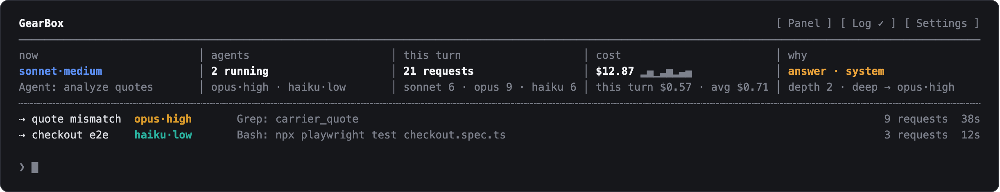
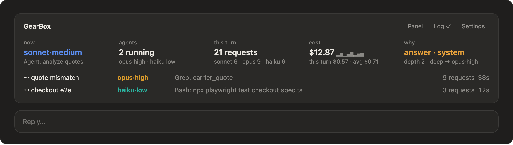

# gearbox

A Claude Code mod that shifts gears for you. Before each prompt, a quick Sonnet call *describes* the request: how much of the project it touches, how costly a mistake would be, how subtle it is, and whether the turn will write code, answer, review a change, drive a browser or wait on a long command. gearbox's own rules turn that description into a gear, and the turn runs there. Browser checks and long commands go to cheap subagents, and on a long conversation Haiku takes the runs of reads (fetching logs, reading files), so the expensive model plans and judges instead of clicking, waiting and fetching.

It works in two modes, picked by the model the session runs on:

- **Steer** (any model but Haiku, for example Opus 5.5): the session keeps its model, so its prompt cache and reasoning stay intact. gearbox sets each turn's effort and hands tool-heavy and Fable-level work to subagents. Changing effort between turns keeps the prompt cache: on Claude Code 2.1.311 with Opus 5.5 and a 70K-token conversation, a switch wrote under 1K tokens to the cache, the same as an unchanged turn.
- **Shift** (a session on Haiku): gearbox also picks the model per turn (haiku, sonnet, opus, fable), only ever moving up.

Built and tested on Claude Code 2.1.311. The mod API is early access and may change between releases.

## Install

### Claude Code in a terminal

At the prompt of a terminal session:

```
/plugin install gearbox --marketplace gnuh/gearbox
```

Answer `y` to add the marketplace, then pick a scope. The user scope loads gearbox in every session, including the desktop app's local Code sessions. From a shell instead: `claude plugin install gearbox --marketplace gnuh/gearbox`.

### Claude desktop app

`/plugin` does not run in the desktop app's Code tab; use the Plugins menu instead:

1. Open the **Code** tab and start or open a session.
2. Click **+** next to the prompt box, then **Plugins**.
3. Choose **Add marketplace** and enter `gnuh/gearbox`.
4. Find **gearbox** in that marketplace's list and choose **Add plugin**.
5. Start a new session. The status line under the prompt box shows `gearbox: …` once the first turn runs, and `/gearbox` reports the mode and settings.

gearbox works with its defaults right away. To change a setting, type `/gearbox settings` in a session (see Settings below).

### After installing

Work as usual: on Opus (or Sonnet) for steer mode, or start on Haiku (`/model haiku`) for shift mode. The defaults suit most work; change them with `/gearbox settings`. To get a newer version later: `claude plugin update gearbox` from a shell, then `/reload-plugins`.

## Settings

The defaults are ready to use. To change one, type in any session, terminal or desktop app:

- `/gearbox settings`: a panel with a row of buttons per setting; the value in use is marked, press another to switch.
- Or directly: `/gearbox effort high`, `/gearbox navigator haiku`, `/gearbox steer off`, `/gearbox escalate code`, `/gearbox strict off`, `/gearbox log on`.

A change applies from your next prompt and is kept for later sessions. What you set with `/gearbox` wins over the plugin's own options, which you can also set from a shell (`claude plugin configure gearbox@gearbox --values-stdin`) where you prefer.

| Setting | Default | |
|---|---|---|
| coding effort (`/gearbox effort`) | `xhigh` | Effort for writing code: `medium`, `high`, `xhigh` or `max`. Every code turn runs at least at it, small edits included; answers and explanations follow their difficulty. gearbox never asks before using it. `max` is the most thorough, the slowest and the costliest, so it goes only to subtle or hard code (depth 2 and up): small code, follow-ups like "do it", turns that start editing and code-writing subagents stop at `xhigh`; Anthropic suggests `medium` for Opus 5.5, which beats Opus 5 at `high` on coding, if you want faster, cheaper turns. Ultracode is not an effort but Claude Code's own switch for multi-agent workflows (type the word in a prompt, or `/effort ultracode` for the session); a mod cannot turn it on per turn, and it works alongside gearbox as it is. |
| steer (`/gearbox steer`) | on | Steer sessions not on Haiku. Off leaves them alone apart from the readout. |
| escalate (`/gearbox escalate`) | on | On a steered session below the model the work calls for (Sonnet, for work the rules put on Opus), hand that work to a subagent on the stronger model: `on` hands up code, reviews, costly work and subtle questions; `code` only work that changes files (code, and fixing what a browser check found) and reviews; `off` keeps everything on the session's model, Fable work included, a review too. |
| strict hand-offs (`/gearbox strict`) | on | During a browser-check or long-command step, the main conversation may not drive the browser or run the test, build or deploy command itself: the call is refused with a note naming the subagent to start. Other shell work, like reading a file or a commit whose message mentions a build, still runs: only the command itself counts, not its quoted text. Off lets the model do it itself, at least at medium effort. |
| band (`/gearbox band`) | on | The band above the prompt (see Live readout). |
| orchestrator (`/gearbox orchestrator`) | off | The main conversation only plans, briefs and reviews, and the work runs in lanes (see Orchestrator). While it is on, `/gearbox orchestrator-model haiku\|sonnet\|opus` (default `sonnet`) and `/gearbox orchestrator-effort low\|medium\|high\|xhigh\|max` (default `medium`) set what the main conversation runs on; the settings panel shows both rows only then. |
| orchestrator agents (`/gearbox orchestrator-agents`) | `3` | While the orchestrator is on, the most agents a request of independent parts goes out to at once: `1` to `6`; `1` turns the fan-out off, so every request is one lane's as before. The orchestrator decides whether a request splits and into how many, never more than this (see Fan-out). The settings panel shows the row (Parallel agents) only while the orchestrator is on. |
| debug log (`/gearbox log`) | off | `on` writes what gearbox decides to a log file (below); `full` also keeps the first 200 characters of each prompt. |
| navigator (`/gearbox navigator`) | `sonnet` | Model of the subagent that clicks through browser checks and only collects evidence: `sonnet` or `haiku` (cheaper). In a side-by-side run on one page both gave identical, correct evidence; Sonnet took 78 s against Haiku's 84 s and Haiku lost a tab once. The main model always does the analysis. |

## The rules

| The survey says | Gear |
|---|---|
| one spot (a question, a rename, a one-line edit) | haiku |
| one feature or a few related files | sonnet |
| many files, or a bug whose location is unknown | opus |
| open-ended design or research | fable, in a subagent |
| a costly mistake (payments, auth, secrets, data) | at least opus · medium |
| a review (a change, diff or pull request looked over for bugs) | at least opus; effort by depth, as for answers |
| depth 0, answering or reviewing | effort low |
| depth 0 / 1 / 2 / 3, writing code | your `code_effort` / your `code_effort` / at least high / at least xhigh (a `max` coding effort: xhigh / xhigh / max / max) |
| depth 1 / 2 / 3, answering or reviewing | effort medium / high / xhigh (max only when you ask) |
| git and GitHub chores (commit, push, tag, a pull request or its description, a comment) | effort by depth like answers: low for plain git, medium when it writes text |

In steer mode the model column only picks subagents' models: the session itself keeps its model unless you name another ("use sonnet for this"), which moves that one turn.

- **Steering a session below the work hands it up.** On a Sonnet session, work the rules put on Opus (many files, a bug whose location is unknown, a costly mistake, a review) goes to an **Opus subagent** at the effort the rules give it, when it is weighty: code past a mechanical edit, a review at any depth, even when the survey is unsure, a costly target, or reasoning at depth 2 and up. Sonnet writes a self-contained brief at high effort (the goal, the limits, what is decided, what was tried and ruled out, what you asked for along the way), and gearbox adds your last few messages under it word for word, so a thin brief cannot drop what you asked. Sonnet reviews what comes back and passes the findings on in full. Mechanical work, a plain answer about the system, or anything Sonnet is enough for stays on Sonnet; naming Opus yourself moves that turn instead. `/gearbox escalate code` hands up only work that changes files, and reviews; a review is always handed up, and only `/gearbox escalate off` keeps one on the session's model.
- **Deep work goes on where it started.** A nod ("go ahead"), a continuation or more of the same work after a hand-off goes back to the same Opus agent with SendMessage, which still holds what it read and found, while its cache is warm (an hour) and its context is under 150K tokens; past that, a fresh agent with a brief. Unrelated work starts a fresh agent. A typed agent that works (not a read-only search such as Explore) started for that work still runs on Opus.
- **What it costs.** Opus 5.5 and Sonnet 5.5 read cached tokens at the same price ($0.20 per million) and Opus costs twice as much to write and to answer. Switching the session's model would write the whole conversation into Opus's cache: about $1.30 at 257K tokens, plus the switch back. A subagent starts from its brief instead, with its own small context. On a long conversation the hand-off costs about what Sonnet doing the work itself costs, and keeps the subagent's reading out of the main context, which every later request re-reads; on a short one it costs more, about 1.4 times in one logged 60K-token session. For a long stretch of Opus work, going back to the same agent beats a fresh one per turn.

- **In shift mode the main model only rises, and never to Fable.** Each model switch writes the whole conversation into the new model's cache, so gearbox shifts up when needed and stays there. The debug log records what each shift costs (`shift` events). Effort changes keep the cache. `/clear` starts over.
- **Fable work runs in a Fable subagent** with a self-contained brief. If you name Fable yourself ("use fable"), that one turn runs on Fable in the main conversation.
- **Browser checks are two steps.** A navigator subagent (**Sonnet** by default, or **Haiku** with the `navigator` setting) clicks through and only collects evidence: what each page showed, values, console errors and failed requests, with no pass or fail. The main model, a different one, then analyzes that evidence, so no model judges its own clicking. When the check calls for a stronger model than the main one (depth 2 and up, or a costly target, on a Sonnet session), an Opus subagent judges the evidence and fixes what is broken instead. Screenshots never enter the main conversation.
- **Long commands** (build, deploy, publish, full test runs, log searches): a **Haiku** subagent runs the exact command and reports only the outcome.
- **Git chores on a long conversation.** Every request in the main conversation re-reads its whole context, so once that passes 100k tokens a commit, push, tag or pull request edit goes to a fresh subagent: **Haiku** for plain git, **Sonnet** at medium when it writes text (a pull request section, a comment). The main conversation settles the brief and reports the outcome. In one desktop session at 330k tokens, a push took 4 main requests and a pull request edit 6; handed off, each takes 2 plus the subagent's. Below 100k, where a subagent's own ~67k-token start costs more than it saves, the main conversation does the chore itself at low or medium.
- **Runs of reads on a long conversation go to Haiku.** Past 100k tokens every main request re-reads the whole context from cache, and Haiku reads it for a quarter of Opus's price ($0.05 against $0.20 per million tokens; output $2.50 against $20). So after two read-only requests in a row (`gh run view`, `grep`, `sed -n`, `git log`, Read, Grep), gearbox sends the next request to Haiku at low effort and holds its reply. A reply that only reads again goes through. Anything else (an edit, a command that changes something, the answer, a long explanation) is thrown away unseen, and the same request goes to the main model, which decides and answers with everything Haiku fetched in front of it. Haiku's first request caches the conversation for an hour (about $0.35 at 344k tokens); within that hour, scouting starts from the first read. A CI investigation in a 344k-token desktop session took 18 Opus requests and $1.65; with scouting it would have cost about $1.10. Haiku cannot read Opus's thinking, so it picks each next read from Opus's visible text and the commands so far; Opus 5.5 does read Haiku's. Below 100k, the main model does its own reading.
- **Side tasks** unrelated to your recent messages go to a subagent at their own gear, unless they are quick edits.
- **Nods** ("ok", "go ahead", "pode seguir") keep the gear of the last real work with no survey, never the low effort of a turn that only briefed a subagent, and never below your coding effort: a "do it" after a proposal is the work itself.
- **What the turn does outranks the guess.** A turn read as a question that starts editing files, or whose test run or build fails, runs the rest of the way at least at your coding effort.
- **Every subagent gets an effort by its job.** A plain subagent Claude starts on its own (outside a hand-off) keeps its model, and its brief gets the same quick read as a prompt: browsing and long commands run at low, code at your coding effort, searches and questions by their depth. Without this they inherit the session's effort, xhigh included. Typed agents (Explore and the like) keep their own.
- **Hand-offs are enforced.** A plain subagent started during a hand-off step runs on that step's model and effort, whatever the call named (typed agents such as Explore keep theirs). With strict hand-offs on, the main conversation cannot drive the browser, run the long command or do the git chore itself during such a step (reading, such as `git log` or `gh pr view`, stays allowed); with it off, doing so raises its effort to at least medium.
- **Asking you first.** Before Fable or xhigh/max effort, gearbox asks, offering a cheaper gear. It skips the question when the effort is your own `code_effort`, or when you asked for that model or effort yourself: the survey must report the ask *and* the word must appear in your own text, outside code and quotes.
- **Slash commands and skills set their own effort.** A `/command` turn does not inherit the gear of your last prompt: the skill's own `effort` frontmatter applies, else Claude Code's usual effort. So does `ultrathink` in your own words.
- **A review skill's fork runs on Opus.** A skill that runs forked (in a loop of its own, as `code-review` does when the model calls it) inherits the session's model and effort, and nothing announces it as a subagent start. When the model calls a skill whose name says review (`code-review`, `security-review`), gearbox finds its fork through the Skill tool's answer or the session's list of agents, and runs every request of it on Opus at least, at the effort of the turn's own work (medium when the turn had no reading of its own, such as a nod). Other skills' forks inherit the session's model and effort, as before. A forked `/code-review` you type yourself is not covered: nothing gearbox sees comes before its fork.
- **Hands off otherwise.** Prompts nobody typed (notifications, schedules) run on the current gear without a survey.

## Multi-step requests

A prompt with several steps ("go to Jira, check the task, build it, test it in Chrome and with Playwright, then commit") becomes a numbered route the main model reads, each step with its own executor and effort. For that prompt, on Opus with `code_effort` xhigh:

| Step | Runs on | Effort |
|---|---|---|
| Read the Jira task | Haiku subagent, returns the task word for word | low |
| (or) Search the vault for earlier decisions | Haiku subagent, returns each matching note in full | low |
| Build the change | main conversation (Opus) | xhigh |
| Check it in Chrome: navigate | Sonnet subagent, evidence only | low |
| Check it in Chrome: analyze | main conversation (Opus) | medium or higher |
| Run Playwright | Haiku subagent, outcome only | low |
| Commit | main conversation (Opus), or a Haiku subagent once the conversation passes 100k tokens | low |

On a session below the model the request calls for (Sonnet, for work the rules put on Opus), its subtle or costly steps (code, a question or plan, the analysis of a browser check, at depth 2 and up, or ordinary steps with a costly target) go to Opus subagents at the step's effort, as `/gearbox escalate` allows; the main conversation briefs each one at high and reviews what it returns.

Name a model for a step and it wins over the settings ("navigate with haiku"), but only if the word is in your own text, outside code and quotes. The main model calls gearbox's `phase` tool as each step starts, and gearbox sets its effort for that step (until the first call, the turn runs at the effort of its main work step); effort changes keep the prompt cache. Other models come in as subagents, since switching the main conversation's model mid-turn would restart its cache; the one exception is Haiku taking runs of reads on a long conversation, where it pays. The status line shows the step under way, `gearbox: opus·xhigh · step 2/6 build the change`.

## Orchestrator

Off by default. With `/gearbox orchestrator on`, the main conversation runs on the orchestrator model at the orchestrator effort (Sonnet at medium, unless you change them), whatever model the session was on. The first request on another model writes the conversation into that model's cache once, and the debug log records it as a `shift`. Steer and shift stand aside while it is on.

- **What stays on the orchestrator:** answers that need no deep look (one spot or one feature, ordinary care) and a one-spot mechanical edit of ordinary care. Costly work and reviews never stay, a review the survey is unsure about included. Any other request the survey is unsure about is not handed off either.
- **Steps it keeps still go out.** When a request it keeps has several steps and one is a lookup, a long command or a browser check, it becomes a route, as in steer mode: lookups and long commands go to Haiku subagents, a browser check's clicking to the navigator, and the orchestrator does the other steps itself, judging the navigator's evidence included. The main conversation stays on the orchestrator's model and effort for the whole route: the phase tool does not change its effort there.
- **What goes to a lane:** everything else that is not split into independent parts (see Fan-out), on the model the rules above give it and at the effort they give it; a review goes to the Opus lane, sure or not. A long command waits in Haiku's lane, a git chore in the chore gear's. Several steps in a request a lane takes are one piece of work for that lane. Fable's open-ended work is a fresh agent, never a lane.
- **A lane is one subagent per model**, started at the top effort (`xhigh`, or `max` with a `max` coding effort or a job that asks for it). Each message to it lowers the effort to its job: gearbox rewrites the effort of every request of the lane. `bench/lanes` measured this: a resumed agent takes the effort a mod sets, the cache stays (about 300 tokens written against 34K read), and lowering takes hold fully (an agent started at `xhigh` and set to `low` thinks like one started at `low`), while raising only half does (a `low` agent set to `xhigh` thinks about 30% less than one started at `xhigh`). That is why a lane starts high.
- **A lane goes on** while its cache is warm (an hour) and its context is under 150K tokens: a nod, a continuation or more of the same work goes to it with `SendMessage`; past that, a fresh lane starts from a brief. The brief carries your last few messages word for word, as for any hand-off.
- **Strict applies.** Until the lane starts, the main conversation may make a few reads for the brief but not edit or run commands; and it writes no code at all, except the one-spot edit its plan kept. `/gearbox strict off` lifts both.
- **Independent parts run at the same time**, one agent each, up to `orchestrator-agents` of them (see Fan-out).
- **Not yet:** the browser check's navigator and judge split when a lane takes the whole request (that lane navigates and judges its own clicks; in a route the orchestrator keeps, the navigator clicks and the orchestrator judges), a second lane when one is busy outside a fan-out, a fan-out in steer mode, judging a part's difficulty from the real diff, and telling a lane which files the others changed.

### Fan-out

A request made of pieces that do not need each other's results and do not edit the same files goes out to several agents in parallel, one per piece: separate investigations, reviews of one change from different angles, features in different services, research next to an edit. The orchestrator decides whether to split and into how many; you only set the most it may use (`/gearbox orchestrator-agents`, default 3).

- **When it splits.** The survey lists such pieces as `parts`, each with what it does, its kind (code, answer, review, long command, lookup), its depth and the files or areas it touches; anything that needs another piece's result, or edits the same files, is not a part, and when in doubt it does not split. A request with steps one after another is still a route or one lane's work: phases stay sequential, parts run side by side. Only a sure reading fans out; a guess hands nothing off, and an unsure review still goes to the Opus lane whole. What the orchestrator keeps for itself (a small answer, a one-spot edit) stays with it, parts or not, and Fable's open-ended work is never split.
- **How many agents.** gearbox decides from the survey's parts, never more of them: a depth-0 part is not worth an agent and joins the part that touches its files, else its neighbour; parts where one edits files the other touches, or both edit code in one folder (or code that names no files), become one agent, so editing agents never collide, while parts that only read may share files (two reviews of one diff still split); past the cap, the lightest part joins the one most like it. Fewer than two left means no fan-out: one lane takes it, as before.
- **Each part's gear** comes from the same rules as a whole request: the model from the request's reach and care, the effort from the part's own depth and kind, a review on at least Opus, a costly request lifting every part to at least opus·medium, lookups and long commands on Haiku at low. A part's gear that would need your consent is put to you, as a route step's is.
- **One message, all at once.** The orchestrator is told to start every part in one message: plain Agents, each with its part's model and a brief for that part alone, the description `part N: ...`, in the foreground, and to wait for every result before going on. gearbox binds each call to its part (the number in its description, else the next part not started), sets its model, starts it at the top effort as a lane (`run_in_background` false) and lowers each of its requests to its part's effort. Your last few messages go under each brief, marked as context: the brief is that agent's part alone. A plain agent started past the planned parts gets an effort by its job, and is no lane.
- **Worktrees.** When two or more parts edit files, each editing part's agent starts with `isolation: "worktree"`, in a git worktree of its own, and hands back its branch; the orchestrator merges them into the working tree (`git merge` or `cherry-pick`; a conflict that needs editing goes back to an agent). A single editing part, and parts that only read, work in the working tree.
- **Lanes.** The first part of each model goes to that model's lane by `SendMessage` when the lane is idle and worth going back to, or its agent becomes the lane when there is none; a busy lane is left to its work. Other parts of the same model, and editing parts in worktrees, are fresh agents for that turn only. A nod or a continuation afterwards goes back to the first part's lane, not to a new fan-out.
- **Strict applies.** Until every part's agent has started, the orchestrator may read a little but not edit or run commands; the refusal says how many agents are still owed. Then it reviews and reconciles what came back and runs the combined check (tests, build) itself, or through a Haiku agent for a long command.

## Live readout

gearbox shows which model every loop is running on at this moment: the main conversation and each subagent, in either mode.

- **Spinner:** the working loop's line names the model and effort of its request in flight, `Sauteing… on opus · xhigh`. Claude Code's own effort display shows the session setting, not what gearbox sent; this one is live.
- **Band above the prompt** (terminal and desktop app): GearBox and three actions, five live columns, then a row per running subagent. In the terminal, here with Sonnet as the session and an Opus subagent handling the hard analysis:

  

  The desktop app draws the same as a card, with its own buttons and no rules:

  

  **now** is the model·effort of the main conversation's request in flight and what it is doing; **agents**, the subagents running, grouped by gear; **this turn**, the requests sent since your prompt, per model; **cost**, the session's cost (as `/cost` counts it) with a bar per recent turn, this turn's and the average; **why**, why this gear (`route 2/5`, `code · area`, `/review`). Each running subagent gets a row: what it was asked to do, its gear, the tool it runs now, the requests it has sent and how long it has run, with `answered by …` when a fallback answered on another model. Up to five rows; past that, the last says `+N more · Panel`. A terminal under 100 columns keeps now, agents and cost. **Panel** opens the models table, **Log** turns the debug log on or off, **Settings** opens the settings panel, where the coding effort is set. Nothing unknown is drawn as a dash. Bands other mods draw in that slot stay, under gearbox's. `/gearbox band off` turns it off.
- **Panel:** `/gearbox panel` (or `/gearbox pane`) opens a table of every loop in the session, nested under the loop that started it, with its model, effort, the tool it is running and its step count. A row says `answered by …` when a fallback answered on a different model than the one requested. **Hide finished** at the top keeps only what is running (the main conversation stays); **Show finished (n)** brings the rest back. The choice is kept; `/gearbox panel running` or `/gearbox panel all` sets it too.
- **Status line:** the main gear plus the running subagents, grouped by gear, `gearbox: opus·high ⇢ 3 agents: sonnet·low ×2, haiku·low`.

All four read one shared record that is updated when a subagent starts, as each request leaves (so the readout is never a step late), when the reply returns, on each tool call and when a turn ends.

## What the survey sees

The rules, your new prompt (up to about 4,000 characters, as JSON), your last three messages (200 characters each), and the previous gear. Never files, tool output or the model's replies. It is one Sonnet call at low effort, two to three seconds per prompt, with no cap on the length of its answer. If it corrects itself mid-reply, its corrected answer is used. Sonnet, not Haiku: replaying 79 real prompts through both, Haiku handed main work to a subagent as a "side task" 8 times (Sonnet once), turned a question into a multi-step route and sent a design question to Fable; Sonnet took about a second longer. If it is unsure, its best guess sets the effort but nothing is handed off, except a review, which is handed off all the same (unless `escalate` is off); if its reply is unusable, the turn keeps the previous gear, never below your coding effort. A subagent's brief is read the same way when it starts, by Haiku, since only the kind of job matters there and several often start at once.

## Commands

| Command | |
|---|---|
| `/gearbox` | status: mode, settings, current gear |
| `/gearbox settings` | open the settings panel |
| `/gearbox log` | show the debug log's path, last decision and last request; `/gearbox log on\|off\|full` turns it on or off |
| `/gearbox effort <medium\|high\|xhigh\|max>`, `/gearbox navigator <sonnet\|haiku>`, `/gearbox steer <on\|off>`, `/gearbox escalate <on\|code\|off>`, `/gearbox strict <on\|off>` | change one setting directly |
| `/gearbox panel` | open the live table of every loop's model (`/gearbox pane` works too); `/gearbox panel running` lists only what is running, `/gearbox panel all` everything |
| `/gearbox on`, `/gearbox off` | turn gearbox on or off (off leaves every session alone, no readout) |
| `/gearbox ask on`, `/gearbox ask off` | ask before Fable or xhigh/max |
| `/gearbox usage` | calls, tokens and estimated cost per model, subagents included |
| `/gearbox usage reset` | clear the usage ledger |

Each survey reply goes to the debug log (`claude --debug`).

## Tuning

The survey prompt and the rules are in `hooks/policy.ts` (`SURVEY`, `gearFor`, `plan`). The prices behind the cost estimates are `PRICES` in `hooks/register.tsx`. Run the tests with `claude plugin test .`.

## Debug log

`/gearbox log on` (off by default) writes one JSON line per event to `~/.claude/gearbox/logs/<session-id>.jsonl`, so you can see what gearbox decided and why:

- `session`: gearbox and Claude Code versions, the session's model, and the settings in force with where they came from.
- `settings`: settings changed outside `/gearbox` (the settings panel, another session), with their new values, at the prompt where they take hold.
- `prompt`: its kind (typed, command, notification, ultrathink) and length. The text itself is kept only with `/gearbox log full`, first 200 characters.
- `survey`: the quick Sonnet check's reply, how long it took, and how it was read.
- `gear`: the gear chosen and why (for example `survey: code, area, depth 1`, `nod: the last work gear, at least your coding effort`, `survey unreadable: previous gear, at least your coding effort`), plus any hand-off or route.
- `fan`: with the orchestrator on, a reading that listed parts: the parts as the survey gave them, the `cap` (`orchestrator-agents`), how many agents it `kept` (0 when it did not fan out) and which parts it `merged` into one agent. The `gear` event's hand-off then reads `fan × 3 → opus·medium, sonnet·high, sonnet·xhigh`.
- `phase`, `agent` (a subagent re-geared: asked versus set, `up` when it takes work handed up to a stronger model, `lane` with the effort a lane or a fan-out's part starts at, `part` and `isolation: worktree` for a fan-out's part, and `why: its job` outside a hand-off; `type: skill` for a review skill's fork, once, with the skill and how its loop was found: `result`, `listed`, or `fallback` for the first agent the list does not know), `spawn` (a subagent started: its id, type and model, `deep` when follow-ups go back to it, `lane` when it became its model's lane, `part` for a fan-out's part; its own `step` lines carry that id as `loop`), `resume` (a follow-up sent back to that agent or lane, with the `part` it took in a fan-out), `skipped` (a deep hand-off whose agent the main model never started, or a fan-out with `owed` parts never started), `strict` (a refused call; `mode: fan` with how many agents were `owed`), `raise` (effort raised: the model did a hand-off step itself, the turn edits files, or a test or build failed), `shift` (in a Haiku session, the main model moving up and what re-caching the conversation cost).
- `scout`: a main request tried on Haiku: kept or thrown away, the tools it called, its tokens, and on the first try in an hour what caching the conversation for Haiku cost.
- `step`: every request, main conversation and subagents: the model and effort gearbox **sent**, what Claude Code's own setting would have sent, the model that answered, and tokens.

`/gearbox log` shows the file's path, the last decision and the last request. Claude Code's own effort display shows its session setting, not what gearbox sent per request; the log's `step` lines show both. `bench/compare.py` reads the log to add the effort sent per request to its comparison. The log stays on your machine; delete the folder whenever you like.

## Does it pay off?

`bench/` has a side-by-side test: the same real tasks on plain Opus and with gearbox, compared on cost, time and quality from Claude Code's own transcripts. See [bench/README.md](bench/README.md).

## License

MIT, see [LICENSE](LICENSE).
