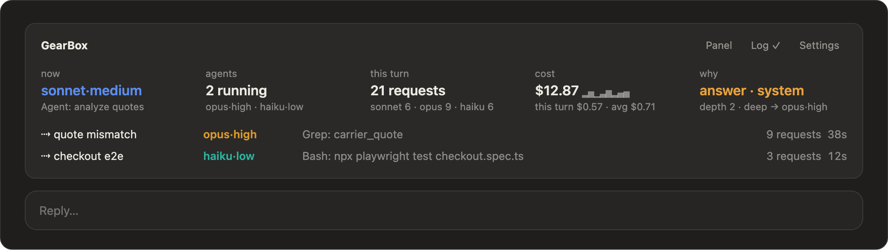
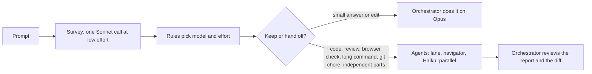

# gearbox

A Claude Code mod that picks the model and effort for every prompt and sends tool-heavy work to cheaper agents, so Opus plans and reviews instead of clicking, waiting and fetching.



## Why

- **The right gear per prompt.** A quick Sonnet call describes the request, and gearbox's rules turn that into a model and an effort.
- **Cheap agents for tool-heavy work.** Browser checks go to a navigator, builds and long commands to Haiku, and git chores to Haiku once the conversation is long.
- **An orchestrator, on by default.** The main conversation stays on Opus and plans, briefs and reviews. Code goes to a long-lived agent, and independent parts run in parallel, up to 6 at once.
- **A live readout.** The band above the prompt shows every agent's model and effort as it works.

## Savings

| Example | Result | Basis |
|---|---|---|
| One `git push` at 330K tokens: on Opus vs handed to Haiku | $0.29 vs $0.17 | priced from `PRICES` in `hooks/register.tsx`; 4 vs 2 Opus requests measured; 3 extra Haiku requests estimated |
| Time added per hand-off | about 32 s on a 136 s task | measured over two days |

The saving grows with the conversation. On short sessions gearbox can cost more: about 1.4 times in one 60K-token session (measured).

<details>
<summary>Where the numbers come from</summary>

- **Measured:** by the author, from gearbox's debug logs (`/gearbox log on`). The request counts and the 1.4 times are under [The rules](docs/REFERENCE.md#the-rules) in the reference, and the 32 s under [Orchestrator](docs/REFERENCE.md#orchestrator).
- **Priced:** tokens times the list prices in `PRICES` (US$ per million tokens, which may have moved).
- **The push:** on Opus, 4 requests that each read 330K cached tokens at $0.20 per million and write 344 output tokens at $20 per million (the logged median). Handed off, 2 Opus requests, a 1,788-token hand-off turn (logged median) and a Haiku agent that starts at 33K tokens (logged median) and makes 3 more requests. Below about 35K tokens the hand-off costs slightly more, so gearbox hands git chores off only past 100K.
- No side-by-side result is published. [bench/](bench/README.md) has the procedure.

</details>

## Install

In a terminal session:

```
/plugin install gearbox --marketplace gnuh/gearbox
```

Answer `y` to add the marketplace, then pick a scope. In the desktop app: Code tab, **+**, **Plugins**, **Add marketplace**, enter `gnuh/gearbox`, add **gearbox**. Update with `claude plugin update gearbox`, then `/reload-plugins`.

## Use

Work as usual. The commands you will use:

```
/gearbox            status and current gear
/gearbox settings   the settings panel
/gearbox panel      every agent's notes, files and cost
/gearbox usage      tokens and estimated cost per model
/gearbox off        leave every session alone
```

| `/gearbox …` | Default |
|---|---|
| `orchestrator auto\|on\|off` | `auto` (on, except Haiku sessions) |
| `orchestrator-model haiku\|sonnet\|opus` | `opus` |
| `orchestrator-effort auto\|low\|medium\|high\|xhigh` | `auto` |
| `orchestrator-agents 1-6` | `6` |
| `model auto\|sonnet\|opus\|fable` (coding model) | `sonnet` |
| `effort medium\|high\|xhigh\|auto` (coding effort) | `xhigh` |
| `navigator sonnet\|haiku` | `sonnet` |
| `log off\|on\|full` | `off` |

Hand-offs are always strict and your own hooks always run for subagents. Neither is a setting.

**Coming from 0.24.0:** the coding model is now `sonnet` unless you set it, so code runs on Sonnet. `/gearbox model auto` lets the rules pick it again.

**Coming from 0.23 or earlier:** the orchestrator is now on unless you set it. Turn it off with `/gearbox orchestrator off`. A session started on Haiku keeps shifting models instead (`/gearbox orchestrator on` orchestrates it too).

<details>
<summary>How a turn flows</summary>



</details>

## More

- [Reference](docs/REFERENCE.md): the rules, orchestrator, live readout, debug log, every command and the changelog.
- [bench/](bench/README.md): a side-by-side test of plain Opus against gearbox.

MIT, see [LICENSE](LICENSE).
