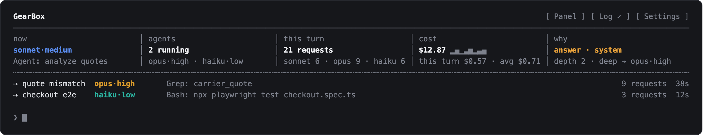
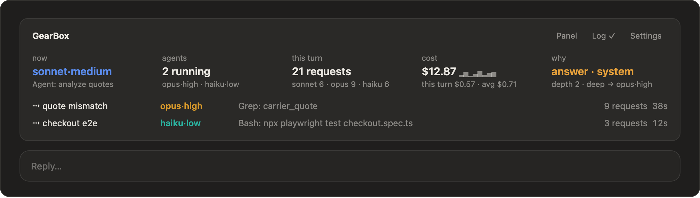

# gearbox reference

The short version, with install, the commands you will use and the defaults, is in the [README](../README.md). This is the full reference.

**Contents:** [Install](#install) · [Settings](#settings) · [The rules](#the-rules) · [Multi-step requests](#multi-step-requests) · [Orchestrator](#orchestrator) · [Live readout](#live-readout) · [Your hooks for subagents](#your-hooks-for-subagents) · [What the survey sees](#what-the-survey-sees) · [Commands](#commands) · [Tuning](#tuning) · [Debug log](#debug-log) · [Does it pay off?](#does-it-pay-off) · [Changes](#changes)

A Claude Code mod that shifts gears for you. Before each prompt, a quick Sonnet call *describes* the request: how much of the project it touches, how costly a mistake would be, how subtle it is, and whether the turn will write code, answer, review a change, drive a browser or wait on a long command. A go-ahead ("lets do it", "continue") is described by the work it approves, read from the assistant's proposal, not by its own few words. gearbox's own rules turn that description into a gear, and the turn runs there. Browser checks and long commands go to cheap subagents, and on a long conversation Haiku takes the runs of reads (fetching logs, reading files), so the expensive model plans and judges instead of clicking, waiting and fetching.

With its defaults, a new install runs the **orchestrator** (see Orchestrator, below): the main conversation stays on the model you picked for the session (`/model`: Opus, Fable, any), plans, briefs and reviews, and the work goes to agents. Turn it off (`/gearbox orchestrator off`), or set it to `auto` (off in a session on Haiku), and gearbox works in two modes, picked by the model the session runs on:

- **Steer** (any model but Haiku, for example Opus 5.5): the session keeps its model, so its prompt cache and reasoning stay intact. gearbox sets each turn's effort and hands tool-heavy and Fable-level work to subagents. Changing effort between turns keeps the prompt cache: on Claude Code 2.1.311 with Opus 5.5 and a 70K-token conversation, a switch wrote under 1K tokens to the cache, the same as an unchanged turn.
- **Shift** (a session on Haiku): gearbox also picks the model per turn (haiku, sonnet, opus, fable), only ever moving up.

Built and tested on Claude Code 2.1.311. The mod API is early access and may change between releases.

## Install

### Claude Code in a terminal

At the prompt of a terminal session:

```
/plugin install gearbox --marketplace gnuh/gearbox
```

Answer `y` to add the marketplace, then pick a scope. The user scope loads gearbox in every session, including the desktop app's local Code sessions. From a shell instead: `claude plugin install gearbox --marketplace gnuh/gearbox`.

### Claude desktop app

`/plugin` does not run in the desktop app's Code tab; use the Plugins menu instead:

1. Open the **Code** tab and start or open a session.
2. Click **+** next to the prompt box, then **Plugins**.
3. Choose **Add marketplace** and enter `gnuh/gearbox`.
4. Find **gearbox** in that marketplace's list and choose **Add plugin**.
5. Start a new session. The status line under the prompt box shows `gearbox: …` once the first turn runs, and `/gearbox` reports the mode and settings.

gearbox works with its defaults right away. To change a setting, type `/gearbox settings` in a session (see Settings below).

### After installing

Work as usual. With the defaults the orchestrator keeps the main conversation on the model the session is on (pick it with `/model`; to try Fable, select Fable) and only sets its effort, a session on Haiku included. Steer mode (a session on Opus or Sonnet) and shift mode (a session on Haiku, `/model haiku`) apply only once you turn the orchestrator off, or set it to `auto`, which leaves a Haiku session in shift mode. The defaults suit most work; change them with `/gearbox settings`. To get a newer version later: `claude plugin update gearbox` from a shell, then `/reload-plugins`.

## Settings

The defaults are ready to use. To change one, type in any session, terminal or desktop app:

- `/gearbox settings`: a panel in five blocks, each under its heading and framed apart: **Coding** (model, effort), **Hand-offs** (browser navigator), **Orchestrator** (auto, on or off; its model, effort and parallel agents unless it is off), **Readout** (pulse) and **Debug** (log). Each setting is a row of buttons; the value in use is marked, press another to switch.
- Or directly: `/gearbox model opus`, `/gearbox effort high`, `/gearbox navigator haiku`, `/gearbox pulse off`, `/gearbox log on`.

A change applies from your next prompt, except the debug log, which applies the moment you press it (the settings panel's Log row says so under it, and where the log is written), and the pulse, which applies at once as well; both are kept for later sessions. What you set with `/gearbox` wins over the plugin's own options, which you can also set from a shell (`claude plugin configure gearbox@gearbox --values-stdin`) where you prefer.

| Setting | Default | |
|---|---|---|
| **Coding** | | |
| coding model (`/gearbox model`) | `sonnet` | The model code runs on: `sonnet`, `opus`, `fable` or `auto`. A model fixes it: every turn that writes code, every code-writing subagent and every go-ahead whose work is code runs on exactly that model, at your coding effort, whatever its reach or a costly target would pick; answers, reviews, git chores, browser checks and long commands keep the rules. Where the conversation runs another model, the code goes to a subagent on yours (see Your coding model, under The rules). `auto` lets the rules pick it, as for any work (see The rules), which is how gearbox worked before 0.24.1. `auto` is your word and never read as unset, though the default is `sonnet`: `/gearbox model auto`, the settings panel and a plugin option of `auto` all keep it, and what `/gearbox` stored wins over the plugin option. |
| coding effort (`/gearbox effort`) | `xhigh` | Effort for writing code: `medium`, `high`, `xhigh`, or `auto` to leave delegation to the main conversation: whether to hand work off, to which model and at which effort, once it has read the work. With `auto`, hand-offs are advice and each agent runs on the model and effort its call names, within bounds (see Your coding effort `auto`, under The rules). With a level, every code turn runs at least at it, small edits included; answers and explanations follow their difficulty. gearbox never asks before using it. `xhigh` is the top: `max`, which an older version offered, now reads as `xhigh`, and stays yours to ask for in your own words for one request. Anthropic suggests `medium` for Opus 5.5, which beats Opus 5 at `high` on coding, if you want faster, cheaper turns. Ultracode is not an effort but Claude Code's own switch for multi-agent workflows (type the word in a prompt, or `/effort ultracode` for the session); a mod cannot turn it on per turn, and it works alongside gearbox as it is. |
| **Hand-offs** | | |
| navigator (`/gearbox navigator`) | `sonnet` | Model of the subagent that clicks through browser checks and only collects evidence: `sonnet` or `haiku` (cheaper). In a side-by-side run on one page both gave identical, correct evidence; Sonnet took 78 s against Haiku's 84 s and Haiku lost a tab once. The main model always does the analysis. |
| **Orchestrator** | | |
| orchestrator (`/gearbox orchestrator auto\|on\|off`) | `on` | The main conversation only plans, briefs and reviews, and the work runs in lanes (see Orchestrator). `on` orchestrates every session, Haiku ones included; `auto` is on, except in a session on Haiku, which keeps shifting models; `off` turns it off. The status line of `/gearbox` and the settings panel say which of these is in effect. `auto` is your word and is never read as unset, though the default is `on`: the plugin option is a boolean whose default, true, Claude Code passes in and which means `on`, false is off, and what `/gearbox` stored (`auto` included) wins over it. The orchestrator has no model setting: its main conversation runs on the model the session is on (`/model`), whichever it is, Fable included, and only its effort is gearbox's to set. An `orchestrator_model` an older version stored, or a plugin option still set, is ignored and dropped from what `/gearbox` stored when a session starts; `/gearbox orchestrator-model` says it is gone and changes nothing. While it is not off, `/gearbox orchestrator-effort auto\|low\|medium\|high\|xhigh` (default `auto`) and `/gearbox orchestrator-agents 1-6` set how the main conversation runs; the settings panel shows both rows only then. `auto` sets the main conversation's effort for each prompt, never above `xhigh`: the rules' effort for what the orchestrator keeps, `high` for a hand-off and for an agent's report coming back (see Orchestrator); a level pins it for every turn. `max`, which an older version offered, now reads as `xhigh`. |
| orchestrator agents (`/gearbox orchestrator-agents`) | `6` | While the orchestrator is on, the most agents a request of independent parts goes out to at once: `1` to `6`; `1` turns the fan-out off, so every request is one lane's as before. The orchestrator decides whether a request splits and into how many, never more than this (see Fan-out). The settings panel shows the row (Parallel agents) only while the orchestrator is on. |
| **Readout** | | |
| pulse (`/gearbox pulse on\|off`) | `on` | The dot of an agent at work, and main's while a turn runs, fades in and out in the band, the Panel and the desktop app's cards: the green steps through eight shades in two seconds. `off` keeps it a steady green. Nothing else pulses (`✓ ✗ ◐ ◌ ⚠` stand still). Applies at once; the plugin option `pulse` (a boolean, true by default) is what a new install starts from. See Live readout. |
| **Debug** | | |
| debug log (`/gearbox log`) | off | `on` writes what gearbox decides to a log file (below); `full` also keeps the first 200 characters of each prompt. It is switched here, in the settings panel (the Debug block's Log row), or with `/gearbox log on\|off\|full`, and applies at once either way: the log opens with the session's header and the settings in force. The band has no Log button since 0.27.0. |

Six former settings are now always on, as they were by default: steering a session not on Haiku (`steer`), handing work a session is below up to a stronger model (`escalate`: code, reviews, costly work and subtle questions), the band above the prompt (`band`), a models panel that lists every loop, finished ones included (`pane`), strict hand-offs (`strict`: with a fixed coding effort, the main conversation is held to a deep, lane or fan-out hand-off until its agents start, and the orchestrator is kept from writing code beyond the small edits its plan keeps; with coding effort `auto` those hand-offs are advice and nothing holds them) and your own UserPromptSubmit and Stop hooks for the subagents gearbox sends work to (`agent_hooks`, see Your hooks for subagents). A value an older version stored for them, or a plugin option still set, is ignored, and gearbox drops it from what `/gearbox` stored when a session starts; `/gearbox steer`, `/gearbox escalate`, `/gearbox band`, `/gearbox strict` and `/gearbox hooks` say they are gone and change nothing. To leave sessions alone, turn gearbox off (`/gearbox off`) or disable the plugin.

## The rules

| The survey says | Gear |
|---|---|
| one spot (a question, a rename, a one-line edit) | haiku |
| one feature or a few related files | sonnet |
| many files, a shared module much of the project depends on, or a bug whose location is unknown | opus |
| open-ended design or research | fable, in a subagent |
| a costly mistake (payments, auth, secrets, audit trails, deleting or migrating data, schema changes) | at least opus · medium |
| a review (a change, diff or pull request looked over for bugs) | at least opus; effort by depth, as for answers |
| depth 0, answering or reviewing | effort low |
| depth 0 / 1 / 2 / 3, writing code | your `code_effort` / your `code_effort` / at least high / at least xhigh |
| depth 1 / 2 / 3, answering or reviewing | effort medium / high / xhigh (max only when you ask) |
| git and GitHub chores (commit, push, tag, a pull request or its description, a comment) | effort by depth like answers: low for plain git, medium when it writes text |

In steer mode the model column only picks subagents' models: the session itself keeps its model unless you name another ("use sonnet for this"), which moves that one turn. A coding model you fix replaces the model column for code (below).

- **Steering a session below the work hands it up.** On a Sonnet session, work the rules put on Opus (many files, a bug whose location is unknown, a costly mistake, a review) goes to an **Opus subagent** at the effort the rules give it, when it is weighty: code past a mechanical edit, a review at any depth, even when the survey is unsure, a costly target, or reasoning at depth 2 and up. Sonnet writes a self-contained brief at high effort (the goal, the limits, what is decided, what was tried and ruled out, what you asked for along the way), and gearbox adds your last few messages under it word for word, so a thin brief cannot drop what you asked. Sonnet reviews what comes back and passes the findings on in full. Mechanical work, a plain answer about the system, or anything Sonnet is enough for stays on Sonnet; naming Opus yourself moves that turn instead.
- **Your coding model.** With a model fixed (`sonnet` out of the box, or `/gearbox model sonnet|opus|fable`), code runs on exactly that model at your coding effort (its effort rules unchanged: never below your coding effort, higher for subtle code), whatever its reach or a costly target would pick; other work keeps the rules above. `/gearbox model auto` puts code under the rules above too. Where it runs follows how hand-offs already work, so the conversation's model, and its prompt cache, never change for it:
  - **The conversation runs that model** (a Sonnet session with `sonnet`, an Opus one with `opus`): the code is written here, even work the rules would hand up to Opus.
  - **It runs another**: the code goes to a **subagent on your model**, up or down (an Opus session with `sonnet` hands its features to a Sonnet agent; a Sonnet session with `opus` hands its code to an Opus agent), save a mechanical edit at one spot with nothing costly at stake (a rename, a one-line change), which stays here at your coding effort: a hand-off's brief, start and relay cost more than the edit. The main conversation briefs it at high effort and reviews what comes back, its diff included, as for any hand-off; with a fixed coding effort it is held to that until the agent starts, and a nod, a continuation or more of the same code goes back to that agent while it is worth it. To write all code in the main conversation, start the session on the model you picked.
  - **Fable** runs only in a subagent, as always, unless the session itself runs on Fable. gearbox does not ask you first for it, since you chose it, as it never asks for your coding effort; an effort above your coding effort (xhigh for exceptionally hard code on a `medium` coding effort) is still put to you, and the cheaper answer keeps Fable.
  - **Shift mode** (a Haiku session): the main model rises to your model for code; once it has risen past it (an Opus turn earlier, with `sonnet`), the code goes to a subagent on yours instead.
  - **The orchestrator** keeps small code only when its main conversation (the session's model) is your model, or when it is a mechanical edit at one spot; otherwise the code goes to your model's lane (Fable: a fresh agent, never a lane, unless the session itself is on Fable, which keeps it), and each code part of a fan-out runs on your model. One agent that takes both code and a review of the same files runs on the higher of the two, since a review is never below Opus.
  - **Routes**: a code step runs on your model, here when the main model is it, else in a subagent on it, save a mechanical step of a request with nothing costly at stake, which stays here; the other steps keep the rules.
  - **Subagents**: a plain subagent whose brief reads as code runs on your model, whatever model its call named. Typed agents (Explore, a custom agent) keep their own model, and so does a plain agent the orchestrator starts in a turn with no hand-off (its job is not read).
  - Not covered: a model you name yourself ("use opus for this") wins for that request; a request the survey cannot describe hands nothing off on a guess, as before, so it runs here; and the main conversation editing files in a turn read as an answer is not stopped, only raised to your coding effort.
- **Your coding effort `auto`: the main conversation decides.** With `/gearbox effort auto`, gearbox decides only what must be decided before the main conversation reads anything: its effort for the turn's first request. Whether to hand work off, to which model and at which effort is the main conversation's call, once it has read the files, the plan or the artifact the work comes from, which the quick survey before the turn has not. So how you phrase a request ("vamos fazer", "ok", a detailed ask) never changes the model or effort the work runs on. gearbox recommends, holds each agent to safe bounds, keeps lanes, worktrees and your hooks, and never silently overrides the call. Paired with a coding model (`/gearbox model sonnet` on an Opus session: Opus reads, decides and reviews, Sonnet writes), or on its own:
  - **Hand-offs are advice, and handing off is its default.** The deep, lane and fan-out notes speak for your choice: with the orchestrator on, `The person turned on gearbox's orchestrator so that work like this goes to an agent: the opus lane at high (code · system · depth 2). Hand it off. Keep it here only if it turns out to be a few tool calls, and then say so in one line starting "Keeping it here:". This preference overrides the default of doing work yourself when in doubt.` (the wording predates the orchestrator being on by default); without it, `The person uses gearbox to route work like this to an agent: …`, since you never turned an orchestrator on. A short how-to follows: a plain Agent naming its model and effort, a brief that stands on its own and names any listed skills that apply, follow-ups by `SendMessage` with an `effort:` first line, the fan tool for a lane's work that splits, the diff of code that comes back. In 0.23.0 and 0.23.1 the note said "Decide after reading", and Claude Code's own guidance (do the work yourself when in doubt) won almost every time: eight suggested hand-offs started two agents, both because the person asked. Nothing holds them: the main conversation may keep the work, under the orchestrator too, and a turn that ends without starting or messaging an agent is logged as `kept`, with the reason from its "Keeping it here:" line. A browser check, a long command and a git chore are not advice: they always go to their agents (see Hand-offs are enforced). A question about the conversation that needs no deep look (an answer at depth 0 or 1, whatever its reach) and any request the survey is unsure of, a review included, get no hand-off note at all: a "why …?" or an instruction for later is the main conversation's.
  - **The Agent call wins, within bounds.** However an agent starts (a hand-off's, a fan-out part, a lane, a route step, a side task, a plain agent the orchestrator starts in a turn it kept, any other plain agent), it runs on the model and effort its call names: the effort from medium (a `low` becomes medium) to xhigh (a `max` becomes xhigh); a review, by its hand-off, its part or its brief, never below Opus; Fable put to you first unless you asked for it or it is your coding model. What the call leaves out, gearbox's pick fills, as before. The agent starts at the top effort and runs each request at the chosen one, as a lane does, so a later follow-up that asks for more takes hold in full; a follow-up by SendMessage, which has no effort field, names it on its first line, `effort: high`, which gearbox takes off before the message goes. A lane is that of the model the agent runs on: a Sonnet call where gearbox advised the Opus lane becomes the Sonnet lane, and a nod goes on there. An agent an agent starts (an Explore reader) keeps its rule, Sonnet at low.
  - **It sets its own effort too.** The main conversation's effort is set before it reads anything, so gearbox's `effort` tool (`mcp__gearbox__effort`, with the effort and why) lets it raise or lower its own for the rest of the turn, xhigh at most, once what it has read shows the turn needs more or less thought than it was given; the prompt cache is kept, as for every effort change. Code it writes itself starts at medium and up by the survey's depth (high for subtle, xhigh for exceptionally hard), and an effort it set itself is not raised when it edits files. With a fixed coding effort, or a pinned orchestrator effort, the tool answers that the settings fix it.
  - **A go-ahead's survey reads what was approved.** When the reply a nod approves points to an artifact or a plan (a path in a `claude-artifacts` folder, or a `.md`, `.html` or `.mmd` file that exists), the survey of the work reads that file's text as well, an HTML page as its text, 6,000 characters at most, so the advice follows the spec rather than the reply's summary of it.
  - The debug log marks each agent `chosen: main` or `chosen: rules`, with gearbox's advice (`advised: sonnet·high`) and whether the two agree, and each use of the effort tool as an `effort` event. gearbox never asks you first about code's effort, since you left it to the main conversation.
  - With a fixed coding effort (`medium`, `high`, `xhigh`) all of this stays as it was: hand-offs are hand-offs, held until their agents start, and an agent runs on the gear gearbox gives its step.
- **Code that comes back is reviewed as code.** Every hand-off of code (deep work, a lane, a side task, a route's code step, a fan-out's parts that edit) tells the main conversation to read the change's diff (`git diff` on the files the agent reports) against the brief before it accepts it, not only the agent's report, and to send what needs fixing back to the same agent.
- **Deep work goes on where it started.** A nod ("go ahead"), a continuation or more of the same work after a hand-off goes back to the same Opus agent with SendMessage, which still holds what it read and found, while its cache is warm (an hour) and its context is under 150K tokens; past that, a fresh agent with a brief. A go-ahead goes back only while that agent's model is enough for the work it approves (see below), at no less than that work's effort; work that needs a stronger model, or a model you name, goes by the rules to an agent on that model. Git chores, long commands and browser checks go by their own rules, never back to the agent, and a hand-off whose agent never started is not work under way. Unrelated work starts a fresh agent. A typed agent that works (not a read-only search such as Explore) started for that work still runs on Opus.
- **What it costs.** Opus 5.5 and Sonnet 5.5 read cached tokens at the same price ($0.20 per million) and Opus costs twice as much to write and to answer. Switching the session's model would write the whole conversation into Opus's cache: about $1.30 at 257K tokens, plus the switch back. A subagent starts from its brief instead, with its own small context. On a long conversation the hand-off costs about what Sonnet doing the work itself costs, and keeps the subagent's reading out of the main context, which every later request re-reads; on a short one it costs more, about 1.4 times in one logged 60K-token session. For a long stretch of Opus work, going back to the same agent beats a fresh one per turn.

- **In shift mode the main model only rises, and never to Fable.** Each model switch writes the whole conversation into the new model's cache, so gearbox shifts up when needed and stays there. The debug log records what each shift costs (`shift` events). Effort changes keep the cache. `/clear` starts over.
- **Fable work runs in a Fable subagent** with a self-contained brief. If you name Fable yourself ("use fable"), that one turn runs on Fable in the main conversation.
- **Browser checks are two steps**, in steer mode and under the orchestrator alike. A navigator subagent (**Sonnet** by default, or **Haiku** with the `navigator` setting) clicks through and only collects evidence: what each page showed, values, console errors and failed requests, with no pass or fail. The main model, a different one, then analyzes that evidence, so no model judges its own clicking. When the check calls for a stronger model than the main one (depth 2 and up, or a costly target, on a Sonnet session), an Opus subagent judges the evidence and fixes what is broken instead. Screenshots never enter the main conversation.
- **Long commands** (build, deploy, publish, full test runs, log searches): a **Haiku** subagent runs the exact command and reports only the outcome.
- **Git chores on a long conversation.** Every request in the main conversation re-reads its whole context, so once that passes 100k tokens a commit, push, tag or pull request edit goes to a fresh subagent: **Haiku** for plain git, **Sonnet** at medium when it writes text (a pull request section, a comment). The main conversation settles the brief and reports the outcome. In one desktop session at 330k tokens, a push took 4 main requests and a pull request edit 6; handed off, each takes 2 plus the subagent's. Below 100k, where a subagent's own ~67k-token start costs more than it saves, the main conversation does the chore itself at low or medium.
- **Side tasks** unrelated to your recent messages go to a subagent at their own gear, unless they are quick edits.
- **A go-ahead gets the gear of the work it approves, never of its words.** A nod ("ok", "go ahead", "pode seguir"), a continuation ("lets do it", "continue") or an approval with changes of its own ("yes, but leave the adapters for later") says little about the work, so its words never set the gear. gearbox reads the assistant's last reply, which lays the work out, as a request of its own (a second quick Sonnet call, given the reply up to 8,000 characters), and that reading sets the gear by the same rules as a typed request. The message's own reading can only raise it, and an approval that adds something keeps its own mode (a question stays a question); the steps of the plan are one piece of work, not a route. What the reply's text shows for sure raises it too, whatever the survey makes of it:
  - a database schema or data migration is costly: SQL that changes a schema (`ALTER TABLE`, `ADD COLUMN`, `CREATE TABLE` in capitals, or a whole lower-case statement such as `alter table orders add …`), a migration's file (in `migrations/…` or `db/migrate/…`, or a `.sql` file named by its number or direction, as migration tools name them: `0260_account_notes.sql`, `V45__audit.sql`, `000001_init.up.sql`), a migration named by its kind or tool ("SQL migration", "data migration", "Flyway migration") or a migration command (`prisma migrate`, `db:migrate`). A bare "migration" or "migration script" (a framework upgrade's, a codemod's), an unnumbered `.sql` file (a query's) or lower-case words like "add column sorting" (a UI's) do not count.
  - source files named in code spans across the project are a system's reach, by the rule a fan-out part's files follow: more than three, or files in three or more top-level folders; tests aside, since each change brings its own.

  Words like auth or billing are left to the survey: a proposal names them in passing too often for a rule to count them. So "lets do it" after a plan for a SQL migration, audit records and new routes in a shared Core module runs on Opus (on a Sonnet session, an Opus subagent) at your coding effort, whatever the two words read as. A nod adds nothing to read, so only the work is read; only when the reply cannot be read and shows nothing for sure does a nod keep the gear of the last real work, never the low effort of a turn that only briefed a subagent, and never below your coding effort. A request that does not go ahead with the proposal ("separately, fix the README title") is read on its own words, as before.
- **What the turn does outranks the guess.** A turn read as a question that starts editing files, or whose test run or build fails, runs the rest of the way at least at your coding effort.
- **Every subagent gets an effort by its job.** A plain subagent Claude starts on its own (outside a hand-off) keeps its model, and its brief gets the same quick read as a prompt: browsing and long commands run at low, code at your coding effort (and on your coding model, if you fixed one), searches and questions by their depth. Without this they inherit the session's effort, xhigh included. Typed agents (Explore and the like) keep their own. With your coding effort `auto`, the model and effort its call names win, within bounds, and this read only fills what the call leaves out (and tells a review, which runs on Opus at least).
- **Hand-offs are enforced.** A plain subagent started during a hand-off step runs on that step's model and effort, whatever the call named (typed agents such as Explore keep theirs). The main conversation cannot drive the browser, run the long command or do the git chore itself during such a step, whatever the settings: a fixed coding effort or `auto`, and under the orchestrator for the lane that relays a long command or a git chore. Only the command itself is refused, not its quoted text: reading (`cat`, `git log`, `gh pr view`) stays allowed, and other shell work during the step raises the turn's effort to at least medium. Only `/gearbox off` lets the main conversation do it. With your coding effort `auto`, the step's gear is advice and the call's wins, within bounds.
- **A sub-agent session does its own work, on the model it was launched with.** Whoever starts a sub-agent decides its model and effort. A session whose first typed prompt makes it another session's sub-agent ("Act as the test sub-agent for this task…", "Act as the implementation sub-agent…") runs on the model Claude Code launched it on: never the orchestrator's (the orchestrator does not apply there, so no `shift` either), never moved up to a stronger one, in steer and shift mode alike, Haiku included, whatever a prompt asks. Its effort is the one it was launched at when gearbox can tell: `CLAUDE_CODE_EFFORT_LEVEL` in its environment, or `effortLevel` in the settings its launch passed with `--settings`; Claude Code then sends that effort as it would, and the effort tool says so. The `--effort` flag itself reaches no mod (a request's effort is the session's setting or the model's default, which gearbox cannot tell apart), so with it, or with nothing, gearbox picks the effort from the reading, as for any turn. Such a session gets no deep, lane, fan-out or side-task hand-off, advice or not, under any coding effort; the fan tool splits nothing there, a route's code or answer steps stay there, and nothing is put to you for consent. Its browser checks (to the navigator), long commands and git chores still go to agents. The debug log says so once (`subagent`, with the launch's `model` and `effort`). Only the opening of the first prompt counts ("act as the/a/an … sub-agent", within a few words), and someone else's sub-agent ("act as the reviewer of the sub-agent's work") does not.
- **Asking you first.** Before Fable or xhigh effort, gearbox asks, offering a cheaper gear. It skips the question when the effort is your own `code_effort` (with `auto`, any effort for code), when the model is your own coding model (code on Fable with `/gearbox model fable`), or when you asked for that model or effort yourself: the survey must report the ask *and* the word must appear in your own text, outside code and quotes. With your coding effort `auto`, the effort the main conversation names on an agent's call is never put to you (it is bounded at xhigh); Fable it names is, unless you asked for it, it is your coding model, or gearbox had advised Fable already.
- **Slash commands and skills set their own effort.** A `/command` turn does not inherit the gear of your last prompt: the skill's own `effort` frontmatter applies, else Claude Code's usual effort. So does `ultrathink` in your own words.
- **A review skill's fork runs on Opus.** A skill that runs forked (in a loop of its own, as `code-review` does when the model calls it) inherits the session's model and effort, and nothing announces it as a subagent start. When the model calls a skill whose name says review (`code-review`, `security-review`), gearbox finds its fork through the Skill tool's answer or the session's list of agents, and runs every request of it on Opus at least, at the effort of the turn's own work (medium when the turn had no reading, such as a nod whose work could not be read). Other skills' forks inherit the session's model and effort, as before. A forked `/code-review` you type yourself is not covered: nothing gearbox sees comes before its fork.
- **Hands off otherwise.** Prompts nobody typed (notifications, schedules) run on the current gear without a survey.

## Multi-step requests

A prompt with several steps ("go to Jira, check the task, build it, test it in Chrome and with Playwright, then commit") becomes a numbered route the main model reads, each step with its own executor and effort. For that prompt, on Opus with `code_effort` xhigh:

| Step | Runs on | Effort |
|---|---|---|
| Read the Jira task | Haiku subagent, returns the task word for word | low |
| (or) Search the vault for earlier decisions | Haiku subagent, returns each matching note in full | low |
| Build the change | main conversation (Opus) | xhigh |
| Check it in Chrome: navigate | Sonnet subagent, evidence only | low |
| Check it in Chrome: analyze | main conversation (Opus) | medium or higher |
| Run Playwright | Haiku subagent, outcome only | low |
| Commit | main conversation (Opus), or a Haiku subagent once the conversation passes 100k tokens | low |

On a session below the model the request calls for (Sonnet, for work the rules put on Opus), its subtle or costly steps (code, a question or plan, the analysis of a browser check, at depth 2 and up, or ordinary steps with a costly target) go to Opus subagents at the step's effort; the main conversation briefs each one at high and reviews what it returns. With a coding model fixed, code steps run on it instead (see Your coding model, under The rules).

Name a model for a step and it wins over the settings ("navigate with haiku"), but only if the word is in your own text, outside code and quotes. The main model calls gearbox's `phase` tool as each step starts, and gearbox sets its effort for that step (until the first call, the turn runs at the effort of its main work step); effort changes keep the prompt cache. With your coding effort `auto`, a step's agent is gearbox's suggestion (the call's model and effort win, within bounds), and the main model may set its own effort with the `effort` tool as well. Other models come in as subagents, since switching the main conversation's model mid-turn would restart its cache; the one exception is Haiku taking runs of reads on a long conversation, where it pays. The status line shows the step under way, `gearbox: opus·xhigh · step 2/6 build the change`.

## Orchestrator

On by default (`on`), in every session, Haiku ones included; `/gearbox orchestrator off` turns it off, and `/gearbox orchestrator auto` leaves a session started on Haiku in shift mode. The main conversation runs on the model the session is on, as Claude Code sends it (Fable 5.2 when you select it with `/model`; gearbox never replaces it with an alias or another build), at the orchestrator effort (`auto`, unless you change it): only the effort changes, so the prompt cache stays. A session on Haiku with `on` stays on Haiku, and everything past Haiku's rung goes to a lane. A session on a model gearbox does not know is left alone, as without the orchestrator. On a Fable session the orchestrator keeps Fable-level work (Fable's open-ended work, code fixed to Fable) itself instead of starting a Fable agent, which would be no stronger model, only a brief and a cold start; everything a lower model does still goes to that model's lane. A model you ask for in your own words moves only the turn that stays here, as before. Steer and shift stand aside while it is on. A session started as another session's sub-agent is not orchestrated: it keeps the model it was launched on (see A sub-agent session does its own work, under The rules).

Who decides what: gearbox always sets the orchestrator's own effort for the turn's first request. With a fixed coding effort it also decides where the work goes, as below, and holds the orchestrator to it. With your coding effort `auto`, where the work goes is the orchestrator's decision once it has read it: every lane, deep hand-off and fan-out below is gearbox's advice, whose default is to hand off (the note says you turned the orchestrator on for that, and the orchestrator keeps work only with a one-line "Keeping it here:" reason), each agent runs on the model and effort its call names (within bounds), nothing holds it to any of them nor keeps it from writing code, and it may set its own effort with the `effort` tool (when the orchestrator effort is `auto`); see Your coding effort `auto`, under The rules. A browser check, and the lane that relays a long command or a git chore, are never advice: their clicking and their command stay with their agents whatever the settings.

- **What stays on the orchestrator:** answers that need no deep look (one spot or one feature, ordinary care), and small code of ordinary care (one spot or one feature, mechanical or ordinary depth) when the work calls for no stronger model than the orchestrator's own (with a coding model fixed: only when the orchestrator runs that very model, or for a mechanical edit at one spot). For that size of work a hand-off's brief, start and relay cost more than the work: measured over two days, a hand-off added about 32 s to a median 136 s task. Code that needs smarter decisions (subtle depth, many files, or a stronger model than the orchestrator's) still goes to its lane, and a request that splits into parallel parts still fans out. Costly work and reviews never stay, a review the survey is unsure about included. Any other request the survey is unsure about is not handed off either. With your coding effort `auto`, an answer at depth 0 or 1 stays whatever its reach or care, and so does any request the survey is unsure of, a review included: no lane is even advised.
- **Steps it keeps still go out.** When a request it keeps has several steps and one is a lookup, a long command or a browser check, it becomes a route, as in steer mode: lookups and long commands go to Haiku subagents, a browser check's clicking to the navigator, and the orchestrator does the other steps itself, judging the navigator's evidence included. The main conversation stays on its model (the session's) for the whole route, and at its effort too, unless the effort is `auto`: then the phase tool sets it to each step's, as in steer mode, `xhigh` at most.
- **Its effort, `auto`.** By default the effort of the main conversation is set for each prompt, never above `xhigh`, and the model stays the orchestrator's, so the prompt cache holds. What it keeps runs at the effort the rules give that work (a one-spot answer low, an ordinary one medium, small code at your coding effort). A turn that hands off runs at `high`, since briefing the agent and choosing its effort is where a hand-off is won or lost; a lane that only relays a command (a long command, a git chore) runs at `low`. An agent's report coming back, which the orchestrator reviews with the diff, is `high`. A nod, a continuation or a prompt the survey could not read keeps the last effort, at least your coding effort. A route it keeps follows its steps (see Steps it keeps still go out). What you ask for in your own words ("use high", `ultrathink`, a slash command's own effort) still wins. A level (`low` to `xhigh`) pins every turn to it, as before.
- **A browser check goes to the navigator**, as in steer mode: the navigator (your `navigator` setting, or Haiku or Sonnet when you name one) clicks at low and reports only what it saw, and the orchestrator writes the checklist and judges the evidence, at `medium` with its effort `auto`; when the check calls for a stronger model than the orchestrator's (subtle or costly, on a Sonnet orchestrator), an Opus agent judges and fixes instead. Before 0.23.2 a browser check went to a lane on the work's model, which clicked and judged its own clicks.
- **What goes to a lane:** everything else that is not split into independent parts (see Fan-out), on the model the rules above give it and at the effort they give it; a review goes to the Opus lane, sure or not. A long command waits in Haiku's lane, a git chore in the chore gear's: lanes that only relay the command, which is held to them (the orchestrator may not run it itself), with your coding effort `auto` too. Several steps in a request a lane takes are one piece of work for that lane. Fable's open-ended work is a fresh agent, never a lane.
- **A lane is one subagent per model**, started at the top effort (`xhigh`, or `max` for a job you asked max for). Each message to it lowers the effort to its job: gearbox rewrites the effort of every request of the lane. `bench/lanes` measured this: a resumed agent takes the effort a mod sets, the cache stays (about 300 tokens written against 34K read), and lowering takes hold fully (an agent started at `xhigh` and set to `low` thinks like one started at `low`), while raising only half does (a `low` agent set to `xhigh` thinks about 30% less than one started at `xhigh`). That is why a lane starts high.
- **A lane goes on** while its cache is warm (an hour) and its context is under 150K tokens: a nod, a continuation or more of the same work goes to it with `SendMessage`, unless that work splits into independent parts (see Fan-out), or the work a go-ahead approves needs a stronger model than the lane's (a costly plan the Sonnet lane wrote goes to the Opus lane); past that, a fresh lane starts from a brief. A lane that is still at work is not sent a separate request: that work becomes a new agent (a nod, a continuation or a go-ahead with the lane's own work still goes to it). The brief carries your last few messages word for word, as for any hand-off.
- **The hold.** With a fixed coding effort, until the lane starts the main conversation may make a few reads for the brief but not edit or run commands; and it writes no code at all, except the small code its plan kept. What is not project code it may still write (a mockup or note for you), also while the lane is owed: anything in a `claude-artifacts` folder, and a `.md`, `.html`, `.svg` or `.mmd` file outside the session's git repository. Your coding effort `auto` lifts both, since the lane is advice then; it does not lift the hold of a lane that relays a long command or a git chore on that command itself.
- **A message you type while a turn runs is a new request.** Until 0.28.0 it was ignored: no survey, no note, no hold. It is now read like a prompt typed now (the `survey`, `gear` and `prompt` events carry `mid: true`), while the running turn keeps its gear. If the rules keep it here (an answer, a small edit), nothing changes. If they hand it off, the orchestrator is told, in a note beside your message, which agents are at work now (id, what it was asked, model, the files it edits) and to decide: (a) it is about the work of one of them: `SendMessage` to that agent; (b) it is new work that touches no file one of them edits: a plain Agent in parallel; (c) it is new work on files one of them edits: a plain Agent with `isolation: "worktree"`. The Agent it starts runs on the gear the rules give that work, with your words in its brief. With a fixed coding effort the orchestrator may not do the work itself: until an Agent starts, or a `SendMessage` reaches an agent at work (by its id or its name), its edits and every command that changes anything are refused, and then the hold lifts at once. Reading (`isReadOnlyCommand`: `git diff`, `ls`, `gh pr view`) and what is not project code (see the hold above) stay allowed. A turn that ends with the message untaken logs `skipped` with `mid: true`, and its `turn` event `owed: true`. With your coding effort `auto` the note is advice whose default is to hand off, nothing is refused, and a turn that ignores it is logged as `kept`. Nods, slash commands, notifications and messages that are not yours are left alone.
- **One lane per model per turn.** Of the plain agents of one model the orchestrator starts in a turn outside a fan-out, even in one message, only the first becomes that model's lane (or none, when the turn already sent its lane a job); the others are fresh agents for that turn, each still started at the top effort and lowered to its job. A nod goes back to the first.
- **Independent parts run at the same time**, one agent each, up to `orchestrator-agents` of them (see Fan-out).
- **Not yet:** the browser check's navigator and judge split when a lane takes a whole request of several steps, one of them a browser check (that lane navigates and judges its own clicks; a request that is the browser check, or a route the orchestrator keeps, goes to the navigator), a second lane when one is busy outside a fan-out, a fan-out in steer mode, a fan-out inside one step of a route (inspect first, then the pieces side by side), judging a part's difficulty from the real diff, and telling a lane which files the others changed.

### Fan-out

A request made of pieces that do not need each other's results and do not edit the same files goes out to several agents in parallel, one per piece: separate investigations, reviews of one change from different angles, features in different services, research next to an edit. The orchestrator decides whether to split and into how many; you only set the most it may use (`/gearbox orchestrator-agents`, default 6).

- **When it splits.** The survey lists such pieces as `parts`, each with what it does, its kind (code, answer, review, long command, lookup), its depth and the files or areas it touches; anything that needs another piece's result, or edits the same files, is not a part, and when in doubt it does not split. A request with steps one after another is still a route or one lane's work: phases stay sequential, parts run side by side. Only a sure reading fans out; a guess hands nothing off, and an unsure review still goes to the Opus lane whole. What the orchestrator keeps for itself (a small answer, a one-spot edit) stays with it, parts or not, and Fable's open-ended work is never split.
- **An approval is the work it approves.** The survey reads a message that approves or asks to go on with work under way, even phrased as a question or with a complaint ("yes, but there is more than one PR, why only one service?"), as that work (a long command, code), not as a question the orchestrator keeps, and gearbox reads the work itself from the assistant's proposal (see A go-ahead gets the gear of the work it approves); it is a continuation only when it adds nothing new. Its parts are the message's, else the proposal's. A continuation whose parts the plan would split fans out instead of going back to the one lane; with no parts it goes on in the lane.
- **The fan tool.** The survey sees only your words, so it cannot list pieces only the conversation knows (the four repos behind "the PRs that were opened"). With the orchestrator on, the main conversation calls `mcp__gearbox__fan` with the parts (what, kind, depth, files) before it starts agents, once it sees the work splits: gearbox splits them by the same rules, on this turn's reading (a turn with none, such as a nod whose work could not be read, on an ordinary one) and the cap set now, makes the fan-out the turn's hand-off, the hold included, and answers which agents to start, with which models, all in one message. It says why when a split is not worth it (one agent at a time, depth-0 parts, shared files) and leaves the turn as it was; it changes nothing once the turn's agents have started, in a route, or with the orchestrator off. An agent the main conversation started calls it the same way to split its own work, on the cap the running agents leave (see Agents may start agents, one level deep, under Live readout); its answer holds nothing back and names no lane.
- **How many agents.** gearbox decides from the survey's parts, never more of them: a depth-0 part is not worth an agent and joins the part that touches its files, else its neighbour, whatever room the cap leaves (an agent's fresh context costs more than a mechanical piece; "explain README" read as depth 0 rides with the part listed before it); parts where one edits files the other touches, or both edit code in one folder (or code that names no files), become one agent, so editing agents never collide, while parts that only read may share files (two reviews of one diff still split); a root-level file sits in the root folder alone, so it never merges with work in a folder; past the cap, the lightest part joins the one most like it. Fewer than two left means no fan-out: one lane takes it, as before.
- **Each part's gear** comes from the same rules as a whole request, on the part's own scope: its reach from the files it names (one file, one folder or up to three files is a feature's, Sonnet; more than three files, or files in three or more top-level folders, a system's, Opus; no files named, the request's reach), so explaining one file of a request that names six runs on Sonnet, not Opus. A part of several merged takes the reach of all their files together, never below any one's. The effort comes from the part's own depth and kind; a part of real work (depth 1 and up) is never below Sonnet, a review is on at least Opus, a costly request lifts every part to at least opus·medium, lookups and long commands run on Haiku at low, a code part runs on your coding model if you fixed one (on Fable, a fresh agent, never a lane), and a model or effort you ask for wins. A part's gear that would need your consent is put to you, as a route step's is.
- **One message, all at once.** The orchestrator is told to start every part in one message: plain Agents, each with its part's model and a brief for that part alone, the description `part N: ...`, in the foreground, and to wait for every result before going on. gearbox binds each call to its part (the number in its description, else the next part not started), sets its model, starts it at the top effort as a lane (`run_in_background` false) and lowers each of its requests to its part's effort. Your last few messages go under each brief, marked as context: the brief is that agent's part alone. A plain agent started past the planned parts gets an effort by its job, and is no lane.
- **Worktrees.** When two or more parts edit files, each editing part's agent starts with `isolation: "worktree"`, in a git worktree of its own, and hands back its branch; the orchestrator merges them into the working tree (`git merge` or `cherry-pick`; a conflict that needs editing goes back to an agent). A single editing part, and parts that only read, work in the working tree. Claude Code can make that worktree only when the session's folder is inside a git repository, so where it is not (or gearbox cannot tell), nothing forces the isolation and the note tells each editing part to make its own worktree in the repository that holds its files (`git -C <repo> worktree add <path> -b <branch>`), work and commit there and hand back the branch, which the orchestrator merges all the same.
- **Lanes.** The first part of each model goes to that model's lane by `SendMessage` when the lane is idle and worth going back to, or its agent becomes the lane when there is none; a busy lane is left to its work. Other parts of the same model, and editing parts in worktrees, are fresh agents for that turn only. A nod or a continuation afterwards goes back to the first part's lane, not to a new fan-out.
- **The hold.** With a fixed coding effort, until every part's agent has started, the orchestrator may read a little but not edit or run commands; the refusal says how many agents are still owed. Then it reviews and reconciles what came back and runs the combined check (tests, build) itself, or through a Haiku agent for a long command. With your coding effort `auto`, the split is advice whose default is to hand the parts off (`The person turned on gearbox's orchestrator so that work like this goes to agents: this request splits into 3 independent parts … Hand them off. If the parts turn out to need each other's results, give the work to one agent instead. Keep it here only if …`), each part's model and effort are the ones its call names (a part that reviews on Opus at least), and nothing is refused until the parts start; the fan tool's answer says the same.

## Live readout

gearbox shows which model every loop is running on at this moment: the main conversation and each subagent, in either mode.

- **Spinner:** the working loop's line names the model and effort of its request in flight, `Sauteing… on opus · xhigh`. Claude Code's own effort display shows the session setting, not what gearbox sent; this one is live.
- **Band above the prompt** (terminal and desktop app): a header line, then the main conversation, then the agents it started, grouped by the request each was started for (the **demand**, below), as a tree, two lines each. In the terminal:

  

  The desktop app draws the same as cards, with its own buttons and no rules:

  

  ```
  GearBox  opus·high (auto) · 3 agents · this turn 21 req · $12.87 ▁▃▂▅▃ · why code · area                   [ Panel ]  [ Settings ]
  ──────────────────────────────────────────────────────────────────────────────────────────────────────────────────────────────────
  ● main                            opus·high                                                                          3 req  1m 12s
    Waiting for the 2 parts; part 1 already has green tests · Agent
  ╭────────────────────────────────────────────────────────────────────────────────────────────────────────────────────────────────╮
  │ Orders by customer, and the README output                                                         3 of 4 at work · since 14:02 │
  │ ├─● part 1 · customers            sonnet·medium   main    ⎇ part/customers                               4 req  38s  [ ■ ]     │
  │ │    ✦ tdd   ✦ swanson-e2e                                                                                                     │
  │ │   Grouping orders by customer and adding the totals · Write                                                                  │
  │ ├─● part 2 · README               sonnet·medium   main    ⎇ part/readme                                  6 req  41s  [ ■ ]     │
  │ │   Running the examples to paste real output into the README · Bash                                                           │
  │ │ └─● Explore · uses of paginate  sonnet·low      rules                                                  2 req   9s  [ ■ ]     │
  │ │     Looking for calls to paginate in src/ · Grep                                                                             │
  │ └─✓ review money.ts               opus·medium     rules   done · 6 findings (1 medium: a f…              8 req  51s            │
  ╰────────────────────────────────────────────────────────────────────────────────────────────────────────────────────────────────╯
  ```

  **A demand per box.** Every request you type, and every message you type while a turn runs that an agent takes, is a **demand**, and the agents started for it are drawn together. In the terminal each demand is an Ink `<Box borderStyle="round">` with a dim border (Ink draws the edges; gearbox draws no box characters of its own), 4 columns narrower than the band (the two edges and a column of padding each side), and its first line is its **title**, in bold and cut at the end of the line, with its state right-aligned: `3 of 4 at work · since 14:02` in the wide band and the Panel (the agents of the demand at work, the agents it has, and the time you typed it), `3 at work` or `done` in the narrow band. The rows inside are the agent rows as they were, the flexible column (the worktree, or the end of a finished agent's report) giving up the 4 columns, and the tree guides start fresh in each box. Main's row and its note stay above the boxes. A demand is shown even when it is the only one, and one whose agents have all ended stays, `done`, until your next prompt takes the finished agents off, as the finished agents themselves do. **A finished demand is all grey, like a disabled control.** It is finished when none of its agents is at work (or waiting on its own work) and none of its parts is still queued: a queued part is an idle loop, not an agent, so a demand with only queued parts left is not finished (it reads `2 queued`, not `done`, and keeps its colours). Its border is an explicit grey (`#7C8592`, not the theme's dim border, which some terminals draw in a colour), and its title, rows, glyphs, gear, skill tags and stats are dimmed text with no colour: the `✓` is not green, the `✗` is not red, the model's colour is gone. On the desktop the same holds for the container, its title strip (flatter), the cards and their chips, and the rail (grey); a finished demand has no Stop button (there is nothing to stop). A demand at work is drawn as before, with its dim border. Under 60 columns there is no border: the title line, then the rows. An agent the record gives no demand (one an older version recorded) is drawn as it was, in no box. The title comes from the survey that reads every prompt you type: it returns a title of at most eight words, in English, with its reading (a prompt it gives none for, or that it cannot read, is titled by its first eight words, `…` where it goes on). A nod, a continuation or a go-ahead (`ok`, `go on`, `yes, but skip the docs`) opens no demand: it goes on with the demand whose agents it goes on with. A go-ahead after an answer or a plan, which started no agent, is a demand of its own, titled by the work it approves. An agent an agent started works for its parent's demand. A lane that has reported and is given a new request, by an Agent call that resumes it or by a message, moves to that request's demand; one given more of the same work stays. The agents a slash command's turn starts (a skill's fork, say) work for a demand titled by the command, `/review the diff`; `/gearbox` commands open none.

  The **header** has the main conversation's gear (with `(auto)` when the orchestrator's effort follows the prompt), the agents at work, the requests sent this turn, the session's cost (as `/cost` counts it) with a bar per recent turn, and why this gear (`route 2/5`, `code · area`, `/review`), then **Panel** and **Settings** (where the coding model and effort are set, and the debug log is turned on or off: the band has had no Log button since 0.27.0). Each **agent** takes two lines, or more when it has loaded skills. The first is its identity: its state, what it was asked to do (`part 1: customers` reads `part 1 · customers`), its gear, who set its effort (`main`: the main conversation named it on the call; `rules`: gearbox's), its worktree (`⎇ branch`; `⎇ worktree` when only Claude Code's isolation is known), the requests it has sent and how long it has run, and, at the end of the line, its **Stop** (`[ ■ ]`, below). The second is its latest note, the first line of the text it wrote before calling a tool (markdown off; a request that writes none keeps the last; a long one is cut at a word, with `…`, within 120 characters), followed by the tool's short name dimmed (`Checking the totals · Bash`), which stays beside a new note until the agent's next call replaces it; or the call itself (`Bash: bun test`) until it has written one. Between the two, an agent that has loaded skills has its **skills**: its tags, ` ✦ name `, one per skill in the order it first called it, drawn as dimmed inverse cells (so they read in every theme) with the note's tree indent, in the wide band and the narrow one. Where a line reaches the end of the width, the tags go on in the next, between tags and never inside one, so every skill is shown on as many lines as the list needs (a single name wider than the line is cut with `…`). The main conversation's own skills are not shown, and an agent with none has no such line. A terminal fits the note to its width the same way, at a word, and keeps the tool after it. An agent an agent started nests under it, with `├─ │ └─` guides, as many levels as there are. The states:

  | | |
  |---|---|
  | `●` | working: in a turn. It pulses (see below): the green steps through eight shades in two seconds |
  | `◐` | waiting on background work of its own between turns (main too, while it waits on its agents: `agents at work · main waits · not done yet`, in amber) |
  | `◌` | queued: a fan-out part whose agent the main conversation has not started yet, under main |
  | `✓` | finished: one dimmed line with the first line of its report (`done · 6 findings`), until your next prompt |
  | `✗` | failed, refused (an agent start gearbox did not allow: a second level, a second agent writing code beside one at work, a brief it could not read) or stopped (with Stop or `/gearbox stop`, or by Claude Code itself) |
  | `⚠` | answered by another model than the one requested (`answered by haiku`) |

  **The working dot pulses** (setting `pulse`, on by default). Only the `●` of main, while a turn runs, and of an agent at work moves; `✓ ✗ ◐ ◌ ⚠` stand still, so what is working shows at a glance. Neither surface has opacity in a `Text`, so the green steps through eight shades of itself (full green at the top of the cycle, a green at 28% of its strength at the bottom, down and back up: five tones) once every 2.0 s, and the shade is a function of the clock, so every dot is at the same step. The screen is redrawn on a tick to move it: every 250 ms (one step) with the pulse on, every second with it off (the run times, `4m 30s`, move on it as well; before 0.29.0 they were as of the last redraw, which any loop's request or tool call caused). The tick runs only while main or an agent is in a turn (`state: working`; one waiting on its own work, `◐`, does not need it) and ends within one tick of the last one stopping; the band and the Panel start it when they are drawn. The desktop app steps the same shades (an `Svg` with `isInteractive` could fade smoothly, but it was not verified in the app, and a redraw every 250 ms might restart its animation). The shades are blended with a near-black, so on a light theme the low end is a darker green, not a fainter one.

  At most four live agents are drawn; past that the last line says `+N agents · Panel`; the band is about twelve lines tall plus three for each demand's box (its edges and its title; one line, its title, where there is no border), finished and queued agents taking what room is left (an agent's skill lines count against it, so a long list can push a finished agent into the `+N agents` count; live agents are always drawn). Cost and tokens per agent are in the Panel, not here. A terminal under 100 columns keeps the header's gear, agents and cost, and per agent its state, name (`part 1`), gear, time and Stop (`[ ■ ]`) and its note without the tool, a finished one in a single line with its result, and an agent's own agent in one line. The desktop app draws a row of metrics (**now**, **agents**, **this turn**, **cost**, **why**), then main's card and, for each demand, a bordered container (a round, dim border, clipped to it) with a strip on top that holds the title on the left and the state on the right (`3 of 4 at work · since 14:02`), and under it a card per agent: a rail in its model's colour, chips for the gear, who chose the effort and the worktree, the requests and time with the Stop button (just `■`) after them, a row of `✦ name` chips for the skills it loaded (all of them, wrapping), the note with its tool as a chip, the note before it (`before: …`), an agent's own agents inside its card, a finished one dimmed with its result; four live cards at most, the rest counted. Which agents are alive comes from Claude Code's own agent list, read when the main conversation's turn ends and every few seconds while any agent is alive. So an agent waiting on its own background shell or agent stays, and so does one gearbox never saw start. Nothing unknown is drawn as a dash. Bands other mods draw in that slot stay, under gearbox's. The band is always shown while gearbox is on.
- **Panel:** `/gearbox panel` (or `/gearbox pane`, or the band's **Panel**) opens main's block, then a box per demand (as the band draws it: its title and state on the first line, no border under 60 columns) with a block per loop of that demand, finished ones included, nested under the loop that started it as in the band. A running agent's block has its identity (gear, who set the effort, worktree and its path, and its Stop button at the end of the line), then its requests, time, tokens in and out and cost at list price, its last three notes with the time and the tool each was followed by (the latest in full, the earlier ones dimmed; the latest has none until the agent calls one), the files it read, edited or created (up to six, the latest first) and, after them, `skills: a · b · c`, every skill it loaded in the order it first called it. A finished agent's block closes with when it ended and the first line of its report, then its `skills:` line. A queued part is a line. Main's block is this turn's.
- **Stop** (terminal and desktop app): Esc stops the main conversation's turn and leaves the agents gearbox started running, so each agent at work has a button of its own. It is on every agent that is working or waiting on its own work, and on nothing else (not main, not a finished or refused agent, not a queued part): `[ ■ ]` at the end of its identity line in the wide band, after the requests and time, in the narrow band and in the Panel, and a `■` button in the card's header on the desktop. A press stops that agent **and every agent it started**, however deep (the agent first, so it starts no more), and the button gives way to `stopping…` (`…` in the narrow band) until the engine reports the agent ended; the row then reads `✗ … stopped`. There is no digit hotkey (a digit pressed in an empty prompt would press a band button). gearbox stops an agent with Claude Code's own `TaskStop` tool, as your press: it aborts the agent's request in flight at once, and works on a background agent, a foreground one and one an agent started (checked on Claude Code 2.1.318 in a headless run, where it asked for no permission; an interactive session was not checked). The engine also ended the agents a foreground agent started along with it there, so gearbox calls it only for those still alive. Where `TaskStop` cannot be used (it is not among the session's tools, or the call fails or is refused by a rule or hook of yours), gearbox stops the agent itself: every tool call it makes is refused, and its next request is not sent but ends its turn with a note that you stopped it, so the agent that started it knows its work is incomplete and not to start it again unless you ask. That is weaker (a request or command already running finishes first) and the log says `via: soft`. An agent `TaskStop` said it stopped but that is still running ten seconds later is stopped that way too. To stop everything at once there is no button, only `/gearbox stop all` (below).
- **Agents' reports as they come back** (terminal and desktop app): the report an agent hands back shows under its notification, or under its call when it ran in the foreground, as soon as it ends. The main conversation then replies with its review only (what it checked, what it disagrees with or found missing, the next step) instead of writing the report out again: over two days those relays took a median 12 s each, 35 minutes in all. `ctrl+o` shows the engine's own row.
- **Agents may start agents, one level deep.** An agent the main conversation starts (a lane, a fan-out's part) may start agents of its own, and the note gearbox adds to its brief says what: `Explore` (or `Plan`) agents to read for it, on Sonnet at low effort, or Haiku when it asks, for a one-fact lookup; a plain Agent for work that is not code, which gearbox reads (the brief, by Haiku, as it reads any plain agent's) and runs on the gear that work calls for: a lookup or an answer by its reach and depth (a one-fact lookup is Haiku at low), a review on Opus at least, one long command (a build, a full test run) on Haiku at low, and writing output that is not code (a report, generated data such as the JSON chunks a skill writes into its output folder) like an answer, since the read is told that generated output is not code; and one plain agent at a time that writes code, in the agent's working tree, on your coding model when you fixed one, else on the gear the rules give its brief, at your coding effort or more (with your coding effort `auto`, the model and effort its call names win within bounds, as for any plain agent). Nothing nested asks you for consent: what the main conversation would put to you (Fable, an effort above your coding effort) steps down to Opus and `high`. A second agent that writes code while the first is running is refused, with the way out: name the independent pieces first. **Several pieces side by side:** the agent calls `mcp__gearbox__fan` with the pieces (what, kind, depth, files) and gearbox splits them by the rules of the main conversation's fan-out (see Fan-out): a depth-0 part joins a neighbour, parts that edit the same files or code in one folder become one agent, each part gets its own gear, and two or more that edit each start with `isolation: "worktree"` (else each makes its own). The cap is `orchestrator-agents` less the agents already running, the caller among them, and the parts other fan-outs have promised but not started, so a lane that starts when five agents work under a cap of six can split in two at most; with no room, or with the orchestrator off, the answer says why and the agent does the work itself. The agent then starts one plain Agent per part in one message, described `part N: ...`; gearbox binds each call to its part and sets its model and effort, with no lane and nothing held back. **Review:** the main conversation reviews whatever these agents write. The agent that started a writer is told to read its diff before it reports and to list every file the writer changed; the writer is told to list its files too; and the files a nested agent edits or creates show in the loop that started it as well as in its own, so the list to run `git diff` on is on that agent's row in the Panel. An agent started by one of these may start none (one level only), and neither may it split: it is refused with the reason, and shown as a `✗` row under the agent that asked. A browser check, a git chore, a typed agent that writes code (start a plain Agent) and a brief gearbox cannot read are refused too. A skill's fork (a review's reviewers) runs its agents as it always did. The same added note names the language of the brief notes each agent gives between steps (the band shows them): an agent outside a hand-off never sees your messages, so gearbox reads your last three typed ones (the latest counts most) for common Portuguese, Spanish or English words and letters, and adds one line, `Write the brief notes you give between steps in Portuguese.` Where the language is unclear (a short message, code or a path only) nothing is added. It is read again only when your messages change.
- **Status line:** the main gear plus the live subagents, grouped by gear, with how many wait on their own background work, `gearbox: opus·high ⇢ 3 agents: sonnet·low ×2, haiku·low, 1 waiting`. An agent shows the effort its requests run at, as the band does, not the top one it starts at: it changes with the agent's next request when a follow-up names another.

All of them read one shared record that is updated when a subagent starts, as each request leaves (so the readout is never a step late), when the reply returns, on each tool call and when a turn ends. It holds, per loop, the demand it works for (an id, the title and when it was typed), its gear and who set the effort, its last three notes, the files it touched, the skills an agent loaded, its worktree, the tokens and cost of its requests, and the first line of its report.

## Your hooks for subagents

Claude Code runs your `UserPromptSubmit` and `Stop` hooks for the main conversation only, so a subagent never sees what they give the main model (a project's notes, runbooks, how to reach a database) and nothing asks it to finish what they remind of (updating notes). gearbox puts a subagent through the hooks you already have, the way the main conversation goes through them, with nothing hard-coded and nothing to add to your settings:

- **When a subagent starts or is sent a task** (any Agent call, a lane, a fan-out's part, a typed agent, a workflow's agent, and a `SendMessage` follow-up): your `UserPromptSubmit` hooks run with the subagent's prompt as the input, so a hook that looks for keywords in the prompt matches the subagent's task. What they print (plain text, or `hookSpecificOutput.additionalContext`) is added under the task as "Added by gearbox". A hook that blocks (exit 2, or `decision: "block"`) refuses the spawn, with its reason as the Agent tool's error. A resumed run keeps the message it is resumed with: the follow-up has had its hooks when it was sent.
- **When a subagent stops**: your `Stop` hooks run with the same input as for the main conversation, `stop_hook_active` included. A `decision: "block"` (or exit 2) with its reason, or `additionalContext`, sends the subagent back to work; `continue: false` lets it end. Your own `SubagentStop` hooks run as before.
- **Which hooks**: the command hooks of your user, project, local, `--settings` and managed settings, merged as Claude Code merges them (one handler in two files runs once), and of the enabled plugins (their `hooks/hooks.json`, with `${CLAUDE_PLUGIN_ROOT}`). `disableAllHooks` and `allowManagedHooksOnly` are respected; this plugin's own hooks are left out. They run all at once, in a shell (or the command and `args` as they are), with `CLAUDE_PROJECT_DIR` set and the timeouts of their settings (30 seconds for `UserPromptSubmit` and 10 minutes for `Stop` when a hook sets none). Neither event takes a matcher, so none is read. A hook with an `if` never runs on them, as in Claude Code.
- **What it cannot run**: hooks of another type than `command` (prompt, agent, http, MCP tool). When no command hook is left to run, the subagent gets instead what your hooks gave the main conversation's last prompt, as the engine handed it to the model.
- Because the hooks run on every task, one that records or counts prompts counts a subagent's too; they always run: there is no setting to leave subagents out of them. The debug log records each run as a `hooks` line (the event, the agent, how many context entries, and a block), never the text.

## What the survey sees

The rules, your new prompt (up to about 4,000 characters, as JSON), your last three messages (200 characters each), and the previous gear. Never files, tool output or the model's replies. It is one Sonnet call at low effort, about 1.5 seconds per prompt typically (the median of 333 logged surveys; 9 in 10 finished within about 2.7 seconds), with no cap on the length of its answer. If it corrects itself mid-reply, its corrected answer is used. Sonnet, not Haiku: replaying 79 real prompts through both, Haiku handed main work to a subagent as a "side task" 8 times (Sonnet once), turned a question into a multi-step route and sent a design question to Fable; Sonnet took about a second longer. If it is unsure, its best guess sets the effort but nothing is handed off, except a review, which is handed off all the same; if its reply is unusable, the turn keeps the previous gear, never below your coding effort. A subagent's brief is read the same way when it starts, by Haiku, since only the kind of job matters there and several often start at once. With your coding effort `auto`, a go-ahead's read of the work it approves also gets the text of the files the reply points to (an artifact, a `.md`, `.html` or `.mmd` plan), 6,000 characters at most.

## Commands

| Command | |
|---|---|
| `/gearbox` | status: mode, settings, current gear |
| `/gearbox settings` | open the settings panel |
| `/gearbox pulse <on\|off>` | whether the dot of an agent at work pulses; at once, as the Readout · Pulse row of `/gearbox settings` does |
| `/gearbox log` | show the debug log's path, last decision and last request; `/gearbox log on\|off\|full` turns it on or off, at once (as does the Debug · Log row of `/gearbox settings`) |
| `/gearbox model <auto\|sonnet\|opus\|fable>`, `/gearbox effort <medium\|high\|xhigh\|auto>`, `/gearbox navigator <sonnet\|haiku>`, `/gearbox orchestrator <auto\|on\|off>`, `/gearbox orchestrator-effort <auto\|low\|medium\|high\|xhigh>`, `/gearbox orchestrator-agents <1-6>` | change one setting directly |
| `/gearbox panel` | open the panel: a block per agent, its notes, files, skills, worktree and cost, finished ones included (`/gearbox pane` works too) |
| `/gearbox stop <agent>`, `/gearbox stop all` | stop one agent, and the agents it started, or every agent at work, as the Stop button does. `<agent>` is its id or the start of its name as the band and the Panel show it (`/gearbox stop part 2`; case does not matter). A word that names several agents lists them and stops none; `/gearbox stop` alone lists the agents at work. The Panel does not number its agents, so there is no index to give |
| `/gearbox on`, `/gearbox off` | turn gearbox on or off (off leaves every session alone, no readout) |
| `/gearbox ask on`, `/gearbox ask off` | ask before Fable or xhigh |
| `/gearbox usage` | calls, tokens and estimated cost per model, subagents included |
| `/gearbox usage reset` | clear the usage ledger |

Each survey reply goes to the debug log (`claude --debug`).

## Tuning

The survey prompt and the rules are in `hooks/policy.ts` (`SURVEY`, `gearFor`, `plan`). The prices behind the cost estimates are `PRICES` in `hooks/register.tsx`. Run the tests with `claude plugin test .`.

## Debug log

`/gearbox log on` (off by default) writes one JSON line per event to `~/.claude/gearbox/logs/<session-id>.jsonl`, so you can see what gearbox decided and why:

- `session`: gearbox and Claude Code versions, the session's model, and the settings in force (`code_model`, `code_effort`, `navigator`, `log`, `pulse` and the orchestrator's) with where they came from. Removed settings (`steer`, `escalate`, `band`, `pane`, `strict`, `agent_hooks`) never appear: an older version's stored values are dropped at session start.
- `settings`: settings changed outside `/gearbox` (the settings panel, another session), with their new values, at the prompt where they take hold: `{"code_model": "sonnet"}` after a press on Coding · Model, say.
- `prompt`: its kind (typed, command, notification, ultrathink) and length. The text itself is kept only with `/gearbox log full`, first 200 characters. `mid: true` for a message typed while a turn ran, with how many `agents` were at work; its `survey` and `gear` events (the gear is the running turn's, `hold` says whether the main conversation is held to the hand-off, and `why` ends in `kept here` when the rules keep it) carry it too.
- `survey`: the quick Sonnet check's reply, how long it took, and how it was read. `of: "work"` for the read of the proposal a go-ahead approves, with the `floor` its text showed for sure (`care: costly`, `reach: system`), if any, and `files`: the files the proposal points to that the survey read, each with its `path` and how many characters (`chars`) went in, or `[]` when it read none (a fixed coding effort reads none).
- `demand`: the request the agents that start now work for (see the band): its `demand` id and `title`, logged where a typed prompt opens or goes on with one (`carried: true` when it only goes on with the demand in force), where a message typed mid-turn that an agent is to take opens one (`mid: true`, `pending`: it is taken up by the next agent that starts, which logs `taken: true`), and where a slash command's turn does.
- `gear`: the gear chosen and why (for example `survey: code, area, depth 1`, `survey: code, area, depth 1; code on your coding model, sonnet`, `go-ahead, the work it approves: code, system, depth 1, costly`, `go-ahead after deep work, the work it approves: …; it goes on in the subagent`, `nod, the work it approves unreadable: the last work gear, at least your coding effort`, `survey unreadable: previous gear, at least your coding effort`), plus any hand-off or route.
- `fan`: with the orchestrator on, a reading that listed parts: the parts as the survey gave them, the `cap` (`orchestrator-agents`), how many agents it `kept` (0 when it did not fan out) and which parts it `merged` into one agent. `via: "tool"` when the main conversation named the parts with the fan tool (an agent that did has its `agent` id, and a `cap` that the running agents shrank), with the fan-out's `handoff` label, or `why` it did not split (`writer`: one of its agents was writing code). The `gear` event's hand-off then reads `fan × 3 → opus·medium, sonnet·high, sonnet·xhigh`.
- `phase`, `agent` (a subagent re-geared: asked versus set, `up` when it takes work handed up to a stronger model, `down` when it takes code handed down to your coding model, `why: its job: code, on your coding model` for a plain agent put on it, `lane` with the effort a lane or a fan-out's part starts at, `part` and `isolation: worktree` (`own` when the part makes its own worktree) for a fan-out's part, and `why: its job` outside a hand-off; `type: skill` for a review skill's fork, once, with the skill and how its loop was found: `result`, `listed`, or `fallback` for the first agent the list does not know), `spawn` (a subagent started: its id, type and model, `notes` with the language its notes were asked for, `deep` when follow-ups go back to it, `lane` when it became its model's lane, `part` for a fan-out's part; its own `step` lines carry that id as `loop`), `resume` (a follow-up sent back to that agent or lane, with the `part` it took in a fan-out; since 0.28.0 also a message to any agent at work, which counts as the hand-off), `handed` (`mid: true`: the Agent that started, or the agent a `SendMessage` reached, lifted the hold of a message typed mid-turn, with its `via`), `lanes` (the lanes a session start rebuilt from the readout's record after a plugin reload), `failed` (an Agent call that came back in error or refused before its agent started: the hand-off, `part` included, stays open for the retry), `skipped` (a deep or lane hand-off whose agent the main model never started, a fan-out with `owed` parts never started, or, with `mid: true`, a message typed mid-turn that no agent took), `turn` (the turn's length and whether it was `aborted`, with `owed: true` when a hand-off was never started), `kept` (with your coding effort `auto`, a turn that carried deep, lane or fan-out advice and ended without starting or messaging an agent: the advised `handoff`, and the `reason` from the main conversation's "Keeping it here:" line when it wrote one, 200 characters at most; `aborted` when you interrupted it), `subagent` (once a session: its first prompt makes it a sub-agent, with the words that `said` so, the `model` it was launched on and its `effort`: the launch's, with `effortFrom`, or `by gearbox`), `strict` (a refused call; `mode: fan` with how many agents were `owed`, `mode: mid` for a message typed mid-turn that no agent has taken yet), `raise` (effort raised: the model did a hand-off step itself, the turn edits files, or a test or build failed), `shift` (a main request going out on another model than the last one did, and what re-caching the conversation cost: in a Haiku session the main model moving up, the turn after a slash command or skill that ran on the session's model, a model you asked for one turn and the way back; the orchestrator logs none of its own, since its main conversation stays on the session's model, and before this change it logged one for its own model, `why: orchestrator`).
- `stop`: an agent stopped with Stop or `/gearbox stop`: its `agent` id and `via`: `task` (Claude Code's `TaskStop`, or it had already ended: `why` says so) or `soft` (gearbox's own stop, with `why` TaskStop could not be used, or was still running after ten seconds), the agents stopped along with it (`cascade`), and for one of those the agent whose stop it came with (`by`).
- `hooks`: your hooks run for a subagent: `event` `UserPromptSubmit` with the `agent` type and how many `context` entries they gave (`stopped` with the reason when a hook refused the task), or `Stop` with the agent's id and type, and `again` (with the `block` reason) when it was sent back to work.
- `nested`: an agent started an agent: the caller's `agent` id and the `type`, and how it was allowed, `via`: `reader` (Explore, Plan), `part` (a part of the fan-out it declared, with the `part` number and its `isolation`, `worktree` or `own`) or `brief` (read from its brief, with the `mode` the read gave it: answer, review, wait or code), with the gear gearbox `set`; or `refused` with `why`: `depth` (started by an agent that was started by one), `writer` (another agent of the caller's is writing code), `typed` (a typed agent that writes code), `unread` (the brief could not be read), `other` (a browser check or a git chore). With the coding effort `auto` it carries the same `chosen`, `advised` and `agrees` as `agent`.
- `step`: every request, main conversation and subagents: the model and effort gearbox **sent**, what Claude Code's own setting would have sent, the model that answered, and tokens.

`/gearbox log` shows the file's path, the last decision and the last request. Claude Code's own effort display shows its session setting, not what gearbox sent per request; the log's `step` lines show both. `bench/compare.py` reads the log to add the effort sent per request to its comparison. The log stays on your machine; delete the folder whenever you like.

## Does it pay off?

`bench/` has a side-by-side test: the same real tasks on plain Opus and with gearbox, compared on cost, time and quality from Claude Code's own transcripts. See [bench/README.md](../bench/README.md).

## Changes

- 0.30.0 (2026-11-10): the orchestrator runs on the session's model. The `orchestrator_model` setting is gone (the plugin option, `/gearbox orchestrator-model`, the settings panel's Model row and its `orchestrator_model` key in what `/gearbox` stored): with the orchestrator on, the main conversation stays on the model you picked for the session with `/model`, as Claude Code sends it, and gearbox only sets its effort (the plan's `main` gear carries the session's model; `turn.step` changes the model only for one you asked for in your own words). To try Fable 5.2 as the orchestrator, select it. What is unchanged: the effort rules (kept work at the rules' effort, a hand-off and an agent's report at `high`, a relay at `low`, a browser check at `medium`, `xhigh` at most), the lanes, the fan-out and the cap. What changes with the model: on a Fable session the orchestrator keeps Fable-level work (open-ended work, code fixed to Fable) itself instead of a deep hand-off to a fresh Fable agent; a Haiku session with the orchestrator `on` stays on Haiku (it was moved to the orchestrator's model, Opus by default); a session on a model gearbox does not know is left alone. The status line says `orchestrating on <model>` with the session's model, and the orchestrator reads `on (effort auto, up to 6 agents at once)`. A stored or plugin `orchestrator_model` is ignored and dropped when a session starts; `/gearbox orchestrator-model` says it is no longer a setting. The `shift` log event no longer has `why: orchestrator`. Prices in the cost estimates follow the claude-api table of 2026-11-10: Fable 5.2 is $8 / $40 per MTok (cache write $10, cache read $0.20; was $10 / $50, $12.5, $0.25) and a Sonnet 5.5 cache read is $0.10 (was $0.20); Opus and Haiku are unchanged.
- 0.29.0 (2026-11-06): the working dot pulses, and a finished request goes grey. (1) The `●` of main (while a turn runs) and of every agent at work steps through eight shades of green on a 2.0 s cycle (a wave: full green down to a green at 28% and back, five tones); `✓ ✗ ◐ ◌ ⚠` stand still. The shade is taken from the clock, so all the dots move together, in the terminal band, the Panel and the desktop app's cards (stepped colours there too: an `Svg` fade was left out because it could not be checked in the app and a 250 ms redraw may restart it). The band and the Panel are redrawn on a tick (`$.clock.every` and `$.ui.invalidate("ui.render")`) every 250 ms with the pulse on, every second with it off, only while main or an agent is in a turn; the run times (`4m 30s`) now move on it too, where they stood at the last redraw. A new setting, `pulse` (`on` by default; `/gearbox pulse on|off`, the Readout · Pulse row of the settings panel, the plugin option `pulse`), turns the fade off, and applies at once. (2) A request whose agents have all finished goes all grey, like a disabled control: an explicit grey border (`#7C8592`, since the theme's dim border is tan in some terminals), a dimmed title, and rows, glyphs (`✓` and `✗` included), gear, tags and stats with no colour; on the desktop also the title strip, the cards, their chips and the rail, and no Stop button. A request at work is drawn as before. A request is finished when none of its agents is at work and none of its parts is queued (a queued part is idle, not at work, so a request that only has queued parts left is not finished); the title's `done` follows the same rule, and a request with nothing at work but parts queued reads `N queued`, where it used to read `done`. `Group` (in `loops.ts`) gains `queued`. The settings panel gains a Readout block, and its footer reads `Log and Pulse apply now`.
- 0.28.0 (2026-11-06): a message typed while a turn runs is a new request. (1) It was skipped whole (`prompt.submit` with a turn id returned at once: no survey, plan, note, hold or log line); it is now read like a prompt typed now, the running turn keeps its gear, and, when the rules hand it off, the orchestrator is told which agents are at work and to give it to one of three: `SendMessage` to the agent whose work it is, a plain Agent beside them, or a plain Agent with `isolation: "worktree"` when it touches files an agent edits. With a fixed coding effort it may not edit or run what changes anything until an Agent starts or a `SendMessage` reaches an agent at work; reads and what is not project code stay allowed (see Orchestrator). (2) A lane that is still at work is no longer resumed for a separate request (`seatParts` already left it to its work); that request becomes a new agent, while a nod, a continuation or a go-ahead still goes back to it. (3) A lane hand-off the main conversation answered in text only is now logged as `skipped`, as a deep one was, and a `turn` event carries `owed: true` when a hand-off was never started. (4) A plugin reload keeps the readout's record but lost the lanes, so a `SendMessage` to a live agent matched no lane and the hand-off stayed owed, and notification turns kept refusing `git diff` and a note written outside the repository. Session start now rebuilds the lanes from that record (per model, the newest agent the main conversation started), any `SendMessage` to an agent at work counts as the hand-off (and is logged as `resume`), and a note or mockup (`writesNoCode`) is no longer refused while a hand-off is owed. (5) The agents are grouped by the request they were started for. The survey also returns a title for the request (at most eight words, in English; a missing one falls back to the prompt's first eight words), and each loop records the demand it works for (`demand: { id, title, at }`, an agent an agent started having its parent's; a nod, a continuation or a go-ahead goes on with the demand in force, a lane given a new request moves to it, and a message typed mid-turn that an agent takes is a demand of its own). The terminal band and the Panel draw each demand as a rounded Ink box with its title and `N of M at work · since HH:MM` (`N at work` or `done` in the narrow band) on its first line and its agent rows inside, 4 columns narrower, main's row above them and no border under 60 columns; the desktop app draws a bordered container with a title strip and the agent cards inside. The log has a `demand` event. README: one sentence on the first change and one on the grouping.
- 0.27.1 (2026-11-06): the desktop Stop is a button with only the icon. In 0.27.0 it showed the text `Stop <agent>`, because the desktop draws a Button's label and ignores its children. It is now a secondary button, as the unselected values in the settings are, whose label is just `■`, with no name or tooltip. The terminal's `[ ■ ]` and the Panel's are unchanged.
- 0.27.0 (2026-11-06): stop an agent on its own. Esc stops the main conversation's turn and leaves the agents gearbox started running, so every agent at work (working, or waiting on its own work; not main, a finished or refused agent, or a queued part) now has a **Stop** button: `[ ■ ]` at the end of its identity line in the terminal's wide band, narrow band and the Panel, and a `■` button in its card's header on the desktop, with no digit hotkey. A press stops the agent and every agent it started, through Claude Code's own `TaskStop` tool (checked on 2.1.318 in a headless run: it aborts the request in flight, works on background, foreground and nested agents, and asked for no permission), and the button reads `stopping…` (`…` in the narrow band) until the engine reports the agent ended, then `✗ … stopped`. Where `TaskStop` cannot be used, gearbox stops the agent itself: its tool calls are refused and its next request ends its turn with a note that you stopped it; an agent `TaskStop` left running ten seconds is stopped that way too. `/gearbox stop <agent>|all` does it from the prompt (an agent's id or the start of its name; there is no button for stopping everything), and the debug log gets a `stop` event per agent with `via` (`task` or `soft`) and the `cascade`. The band's **Log** button is gone: the debug log is switched in the settings panel (Debug · Log) or with `/gearbox log`, and a press there applies at once, with the session header and what was pending written, where it used to wait for the next prompt; the row says so, and where the file is, under it. The settings panel's footer now reads `The marked value is in use. Log applies now; the rest from your next prompt. Esc closes.` `assets/band-*.png` still show an older band (with `Log`, and without Stop).
- 0.26.0 (2026-11-06): agents start more than readers. An agent the main conversation started (a lane, a fan-out's part) may now start, one level deep: (1) a plain Agent for work that is not code, by what its brief reads as (the Haiku read gearbox already gives a plain agent's brief, told that generated output is not code): a lookup or an answer on the gear its reach and depth call for, a review on Opus at least, one long command on Haiku at low, and writing output that is not code, such as the JSON chunks a skill like graphify has its agents write; (2) one plain agent at a time that writes code, in its working tree, on your coding model (else the gear the rules give its brief, at your coding effort or more; with the coding effort `auto`, the call's model and effort win within bounds); a second while it runs is refused, with the way out; (3) the independent pieces of its own work side by side: it calls `mcp__gearbox__fan` and gearbox splits them by the main conversation's rules (depth-0 parts merge, parts that edit the same files or code in one folder merge, a worktree when two or more edit, a gear per part), on a cap of `orchestrator-agents` less the agents already running and the parts promised, then binds the agent's `part N: ...` calls to the parts. Whatever they write is reviewed by the main conversation, so the agent is told to read its writer's diff and list every file it changed, the writer is told to list its files, and the files a nested agent changes show on the agent that started it too. Still one level: an agent started by an agent starts and splits nothing, and a browser check, a git chore, a typed agent that writes code and an unreadable brief are refused. Nothing nested asks you for consent: Fable and an effort above your coding effort step down. The `nested` log event records `via` (`reader`, `part`, `brief`) with the gear and the part, or `refused` with `why`; the `fan` event of an agent's split carries its `agent`. The "lane splitting its own work across agents" item is off the orchestrator's "Not yet" list. Before, an agent could start only `Explore` and `Plan` agents, and anything else, however harmless, was refused as if it changed code.
- 0.25.0 (2026-11-05): the live readout shows the skills each agent loaded. Every Skill call an agent makes is recorded by name when it is made, each skill once, in the order it was first called (the main conversation's own calls are not recorded or shown). In the terminal band an agent that loaded skills gets its tags between its identity line and its note (`✦ tdd`, `✦ swanson-e2e`), each tag a dimmed, inverse cell that stays readable in every theme, including Dark mode (ANSI colors only); when a line reaches the end of the width the tags go on in the next, between tags and never inside one, so every skill shows, on as many lines as the list needs. The lines are part of the band's row budget, so a long list takes more rows: finished agents give way first, live ones are always drawn. On the desktop each card gets a row of `✦ name` chips between the identity chips and the note, all of them. The Panel gets a `skills:` line with the full list. A Skill call also reads `Skill: <name>` in place of the bare `Skill`. Nothing changes for agents with no skills.
- 0.24.2 (2026-11-05): the hand-off notes ask the main conversation to name, in the brief it writes for an agent (a lane's first brief and its follow-ups, deep work, a side task, each part of a fan-out, a code or answer step of a route), any listed skills that apply to the work and to tell the agent to load them with the Skill tool: `any listed skills that apply (have the agent load them with the Skill tool)`. A handed-off agent starts with no skill loaded, and in the author's logs 33 of 40 subagent Skill calls were of skills the brief had named. gearbox reads no skill list and picks no skill: the main conversation sees the listing and chooses; a long command, a git chore and a browser check carry no such clause.
- 0.24.1 (2026-11-05): a new install starts with the settings the author runs. The coding model defaults to `sonnet` instead of `auto`: code runs on Sonnet (in its lane, under the orchestrator) until you pick another. The manifest's default and the fallback in the code agree, `/gearbox model auto` (or `auto` in the settings panel or as a plugin option) still lets the rules pick it and is never read as unset, and what `/gearbox` stored wins as before. An install that never set the coding model is switched to `sonnet`; `/gearbox model auto` restores the old behaviour. The orchestrator likewise defaults to `on` instead of `auto`, so a session started on Haiku is orchestrated too instead of shifting models; a plugin option of true now means `on`, and a stored `auto` (`/gearbox orchestrator auto`) is kept and never read as unset, so `/gearbox orchestrator auto` restores the old behaviour. Every other default is unchanged: coding effort `xhigh`, the orchestrator on Opus at `auto` effort with up to 6 agents, navigator `sonnet`, log `off`.
- 0.24.0 (2026-11-04):
  - The orchestrator is on by default, on Opus at `auto` effort, with up to 6 agents at once. The coding model stays `auto` and the coding effort `xhigh`. Anything you set keeps its value, so an install that never set `orchestrator` is switched on; `/gearbox orchestrator off` turns it off.
  - The orchestrator setting has a third value, `auto`, the default: on, except in a session on Haiku, which keeps shifting models for people who start there to save money. `/gearbox orchestrator on` orchestrates a Haiku session too. `/gearbox` and the settings panel say what is in effect. A plugin option of true cannot be told from the manifest's default, so it means `auto`; false still means off, and a boolean an older version stored with `/gearbox` still reads (true is on, false is off).
  - Strict hand-offs and your hooks for subagents are no longer settings: both are always on, and a stored value or plugin option for them is ignored.
  - The README is restructured: a short front page, with this reference holding the detail.
- 0.23.2: hand-offs are taken again. With coding effort auto, the deep, lane and fan-out advice speaks for the person's choice (the orchestrator they turned on, or gearbox routing in steer mode): hand off by default, keep the work only with a one-line "Keeping it here:" reason, which the debug log records as `kept` when a turn ends without starting an agent; the notes are a third shorter. Browser checks, long commands and git chores are held to their agents whatever strict and the coding effort say; strict now only holds deep, lane and fan-out hand-offs with a fixed coding effort. The orchestrator sends a browser check to the navigator at low and judges it, instead of an Opus lane. A session whose first prompt makes it a sub-agent ("Act as the test sub-agent…") hands none of its work on and keeps the model it was launched on, never the orchestrator's, and the effort it was launched at where gearbox can tell (`CLAUDE_CODE_EFFORT_LEVEL`, `--settings`). The `shift` event logs only real re-caches: it compares with the model the last main request went out on, not the session's own, so the orchestrator no longer logs one every turn.

Earlier versions are summed up in their release commits (`git log`).

## License

MIT, see [LICENSE](../LICENSE).
